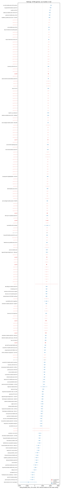
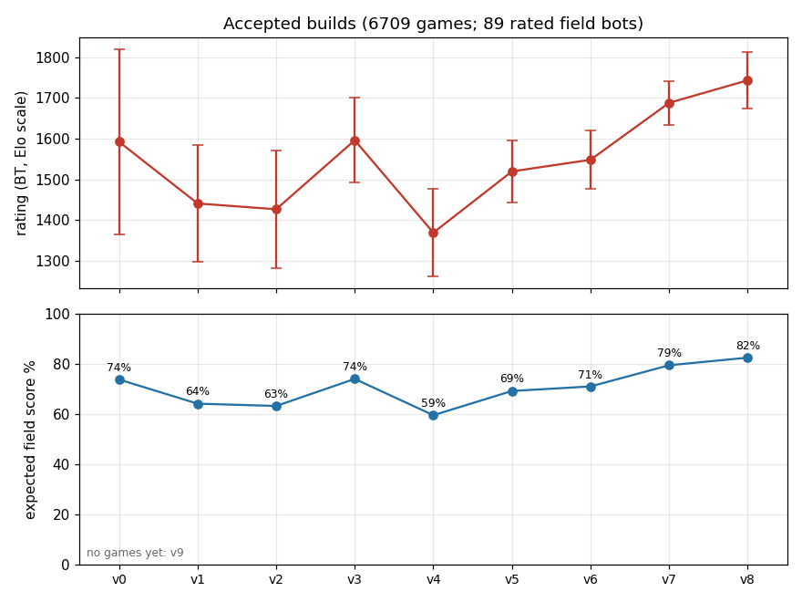

# Ratings (Bradley-Terry)

Written by `tools/progress/elo.py` from `progress/games.csv` (`tools/progress-refresh.sh`): regenerate, do not edit. Latest game 2026-10-25 07:37 PDT.

6709 games: 3243 local (VM batches between our builds, candidates, sparring partners and the starter bot), 1255 of ours on the galaxy replica and 2211 between field bots there (2208 replica games known only from match scores: no map, side or rounds). Rated by a batch Bradley-Terry fit on the Elo scale (`tools/progress/elolib.py`): every game counts, each pair of players at most 200 games, each build its own player, prior 0.1 virtual win and loss against 1500. Ratings are relative to the mean of all 196 players; compare them only within this fit.

**Thin field.** 89 rated field bots (m-schier.battlecode-2019-wololo, mvpatel2000.Battlecode2019, uvafan.bc2019, rafekruse.Battlecode-2019-bc19, yujinwunz.battlecode_2019, VoidMercy.battlecode-2019~e7dc06, j-mao.battlecode-2019, StoneT2000.BC19-botfinalsafe, StoneT2000.BC19-bot1v43, moreda-a.BC2019-a31, awesomelemonade.Battlecode2019, arya-k.bc19, bqi343.cp-notebook, rafekruse.Battlecode-2019~2680d4, IanCoolidge0.battlecode20~69ce88, cemondr.BC19pdxgroup4, virenvshah.Battlecode2019, vineetparikh.BigRedBattle~fe3459, ldcWV.Battlecode-2019, IanCoolidge0.battlecode20~f649f3, Nischay-Pro.BattleCode2019, IvanGeffner.BC19-bot6b, howard36.Battlecode2019-eco6, NielsKornerup.Battlecode-2019, unrevre.battlecode, UpperArlingtonHighSchool.~682aa9, abcdefguan.battlecode2019, lschaberg.bc19, m4reko.bc2019-tmores-angels, dmunozc.bc19-g8-davjasdiv, programjames.BC19Bot-seeding, IvanGeffner.BC19-eigthbot, ovkulkarni.battlecode2019~0aa607, dmunozc.bc19-g8-bots, ovkulkarni.battlecode2019~06c610, 18dcb01.Battlecode19-prea~fb5c48, Tom-CCS.BC19, ipercyNC.group6-battlecode, sunanth123.battlecode19-prorush, programjames.BC19Bot-root, CS554-software-engineerin~a575dc, sunanth123.battlecode19-mainbot, moreda-a.BC2019-t15, evanyeyeye.battlecode2019~af562c, jamesrayman.HCN-bot, cvxluo.battlecode19, CometsTech.battlecode2019, nthistle.battlecode-2019, bayoumi17m.BattleCode-2019, vicennial.BattleCode19, JasonLarson44.2019-Battle~1c7639, Nydroam.BatteredCod, twitu.bc19-tsp, haydenshively.Battle-Code~e1c2fb, spachava753.bc19, UpperArlingtonHighSchool.~5e7875, TestSubjector.BattleCode2~e6de74, 18dcb01.Battlecode19-robot2, dgh2.bc19-t1, dndoja.battlecode19, haydenshively.Battle-Code~e37b3e, TestSubjector.BattleCode2~fb22c7, rooneyshuman.Battlecode, jackliu612.Battlecode19, roy-love.onshoreBattleCode2019, CometsTech.battlecode2019~187e8c, liwanlin41.examplefuncsplayer, asunathanr.asu_bc, jyurkanin.corn_bc19, VictorButoi.BattleCode201~c4576b, howard36.Battlecode2019-sprint, OmarTahoun.battle-code, SethKitchen.examplefuncsplayer, bovard.battlecode-2019-un~8822c3, nhard.examplefuncsplayer, waylon531.scala_starter, vishwasns99.BC_2019, DivyanshuSaxena.Battlecode, VoidMercy.battlecode-2019-bot, jbiewend.Battlecode2019, bc19-starter, ryanhzhao.Battlecode-2019, RyanSharafuddin.Battlecode_2019, djkeyes.bc19, yunaganyh.bc19, TheRobotCarlson.battlehac~323871, jshin313.battlecodebot, jamesrayman.HCN-basic-bot, ArtemUstilov.bc19_CrazyTapok) out of the replica's 86 teams: the whole public field is entered (BENCHMARK.md), but the replica plays a few matches an hour, so only these have rated games against our builds and the field score below is an expected score against them alone, one of them the starter. With so few games the 95% intervals are wide, and ratings will move as the replica's games accumulate. Round-0 init failures (a bot that never started: machine load or a broken bot) are not games and are left out.

Our builds (accepted = bots/ROSTER.tsv v*, candidate = a dist/ bundle, sparring = a training partner). Field score = expected score against every rated field bot (89), one game each; vs higher = the same against only the field bots rated above, with their count.

| build | kind | rating | rank | games | record | field score | vs higher |
|---|---|---|---|---|---|---|---|
| v0 | accepted | 1592 ± 228 | 89 of 196 | 38 | 33-5 | 73.7% | 27.9% (vs 21) |
| v1 | accepted | 1441 ± 143 | 130 of 196 | 154 | 128-26 | 64.0% | 23.8% (vs 34) |
| v2 | accepted | 1427 ± 144 | 135 of 196 | 62 | 30-32 | 63.1% | 22.5% (vs 34) |
| v3 | accepted | 1596 ± 103 | 86 of 196 | 191 | 140-51 | 73.9% | 27.2% (vs 20) |
| v4 | accepted | 1369 ± 108 | 139 of 196 | 220 | 83-137 | 59.4% | 19.9% (vs 37) |
| v5 | accepted | 1520 ± 76 | 107 of 196 | 439 | 202-237 | 69.1% | 25.2% (vs 26) |
| v6 | accepted | 1548 ± 71 | 104 of 196 | 322 | 130-192 | 70.9% | 28.1% (vs 26) |
| v7 | accepted | 1688 ± 53 | 56 of 196 | 1804 | 927-877 | 79.4% | 31.8% (vs 15) |
| v8 | accepted | 1743 ± 69 | 29 of 196 | 353 | 159-194 | 82.4% | 30.8% (vs 10) |
| block | candidate | 1756 ± 163 | 22 of 196 | 20 | 12-8 | 83.1% | 30.2% (vs 9) |
| camp | candidate | 1756 ± 163 | 23 of 196 | 20 | 12-8 | 83.1% | 30.2% (vs 9) |
| h100 | candidate | 1677 ± 72 | 59 of 196 | 200 | 97-103 | 78.8% | 31.7% (vs 16) |
| h101 | candidate | 1652 ± 120 | 67 of 196 | 40 | 18-22 | 77.3% | 30.0% (vs 17) |
| h103 | candidate | 1706 ± 94 | 48 of 196 | 76 | 33-43 | 80.4% | 32.8% (vs 14) |
| h104 | candidate | 1718 ± 104 | 41 of 196 | 58 | 28-30 | 81.1% | 31.3% (vs 12) |
| h107 | candidate | 1598 ± 122 | 84 of 196 | 40 | 15-25 | 74.1% | 27.5% (vs 20) |
| h110 | candidate | 1634 ± 120 | 73 of 196 | 40 | 17-23 | 76.3% | 29.1% (vs 18) |
| h111 | candidate | 1718 ± 104 | 42 of 196 | 58 | 28-30 | 81.1% | 31.3% (vs 12) |
| h112 | candidate | 1718 ± 104 | 43 of 196 | 58 | 28-30 | 81.1% | 31.3% (vs 12) |
| h113 | candidate | 1634 ± 120 | 74 of 196 | 40 | 17-23 | 76.3% | 29.1% (vs 18) |
| h114 | candidate | 1617 ± 121 | 78 of 196 | 40 | 16-24 | 75.2% | 28.3% (vs 19) |
| h115 | candidate | 1704 ± 119 | 51 of 196 | 40 | 21-19 | 80.3% | 33.7% (vs 15) |
| h116 | candidate | 1617 ± 121 | 79 of 196 | 40 | 16-24 | 75.2% | 28.3% (vs 19) |
| h118 | candidate | 1687 ± 119 | 57 of 196 | 40 | 20-20 | 79.3% | 31.7% (vs 15) |
| h11c | candidate | 1551 ± 180 | 103 of 196 | 25 | 15-10 | 71.1% | 28.4% (vs 26) |
| h121 | candidate | 1667 ± 105 | 64 of 196 | 58 | 24-34 | 78.2% | 31.6% (vs 17) |
| h123 | candidate | 1654 ± 105 | 66 of 196 | 58 | 23-35 | 77.4% | 30.2% (vs 17) |
| h124 | candidate | 1652 ± 120 | 68 of 196 | 40 | 18-22 | 77.3% | 30.0% (vs 17) |
| h125 | candidate | 1652 ± 120 | 69 of 196 | 40 | 18-22 | 77.3% | 30.0% (vs 17) |
| h126 | candidate | 1723 ± 91 | 38 of 196 | 98 | 49-49 | 81.3% | 31.9% (vs 12) |
| h127 | candidate | 1713 ± 91 | 44 of 196 | 98 | 47-51 | 80.8% | 30.7% (vs 12) |
| h128 | candidate | 1784 ± 110 | 17 of 196 | 54 | 23-31 | 84.5% | 33.6% (vs 9) |
| h129 | candidate | 1519 ± 131 | 114 of 196 | 40 | 11-29 | 69.1% | 25.1% (vs 26) |
| h130 | candidate | 1731 ± 104 | 37 of 196 | 58 | 29-29 | 81.7% | 32.8% (vs 12) |
| h131 | candidate | 1704 ± 119 | 52 of 196 | 40 | 21-19 | 80.3% | 33.7% (vs 15) |
| h132 | candidate | 1739 ± 120 | 30 of 196 | 40 | 23-17 | 82.2% | 30.4% (vs 10) |
| h133 | candidate | 1722 ± 120 | 39 of 196 | 40 | 22-18 | 81.2% | 31.7% (vs 12) |
| h134 | candidate | 1580 ± 124 | 93 of 196 | 40 | 14-26 | 72.9% | 27.6% (vs 22) |
| h135 | candidate | 1693 ± 104 | 55 of 196 | 58 | 26-32 | 79.6% | 32.3% (vs 15) |
| h136 | candidate | 1696 ± 94 | 54 of 196 | 76 | 32-44 | 79.8% | 32.7% (vs 15) |
| h137 | candidate | 1652 ± 120 | 70 of 196 | 40 | 18-22 | 77.3% | 30.0% (vs 17) |
| h138 | candidate | 1704 ± 119 | 53 of 196 | 40 | 21-19 | 80.3% | 33.7% (vs 15) |
| h139 | candidate | 1746 ± 94 | 27 of 196 | 76 | 37-39 | 82.6% | 31.2% (vs 10) |
| h140 | candidate | 1744 ± 104 | 28 of 196 | 58 | 30-28 | 82.4% | 30.9% (vs 10) |
| h141 | candidate | 1756 ± 104 | 21 of 196 | 58 | 31-27 | 83.1% | 30.3% (vs 9) |
| h142 | candidate | 1722 ± 120 | 40 of 196 | 40 | 22-18 | 81.2% | 31.7% (vs 12) |
| h143 | candidate | 1757 ± 121 | 20 of 196 | 40 | 24-16 | 83.1% | 30.4% (vs 9) |
| h144 | candidate | 1598 ± 122 | 85 of 196 | 40 | 15-25 | 74.1% | 27.5% (vs 20) |
| h145 | candidate | 1796 ± 108 | 16 of 196 | 58 | 31-27 | 85.1% | 35.0% (vs 9) |
| h146 | candidate | 1758 ± 108 | 18 of 196 | 58 | 28-30 | 83.2% | 30.5% (vs 9) |
| h147 | candidate | 1834 ± 109 | 8 of 196 | 58 | 34-24 | 86.8% | 33.3% (vs 6) |
| h148 | candidate | 1818 ± 84 | 12 of 196 | 112 | 58-54 | 86.1% | 35.9% (vs 8) |
| h149 | candidate | 1758 ± 108 | 19 of 196 | 58 | 28-30 | 83.2% | 30.5% (vs 9) |
| h150 | candidate | 1808 ± 109 | 14 of 196 | 58 | 32-26 | 85.7% | 34.7% (vs 8) |
| h151 | candidate | 1707 ± 128 | 47 of 196 | 40 | 18-22 | 80.5% | 32.9% (vs 14) |
| h157 | candidate | 1754 ± 131 | 24 of 196 | 36 | 14-22 | 83.0% | 30.0% (vs 9) |
| h159 | candidate | 1810 ± 98 | 13 of 196 | 72 | 33-39 | 85.7% | 34.9% (vs 8) |
| h161 | candidate | 1754 ± 131 | 25 of 196 | 36 | 14-22 | 83.0% | 30.0% (vs 9) |
| h162 | candidate | 1731 ± 132 | 36 of 196 | 36 | 13-23 | 81.8% | 32.8% (vs 12) |
| h163 | candidate | 1821 ± 85 | 9 of 196 | 108 | 51-57 | 86.2% | 31.6% (vs 6) |
| h167 | candidate | 1864 ± 98 | 7 of 196 | 72 | 38-34 | 88.2% | 37.1% (vs 6) |
| h16r | candidate | 1300 ± 153 | 144 of 196 | 40 | 16-24 | 55.1% | 17.9% (vs 41) |
| h18 | candidate | 1283 ± 196 | 145 of 196 | 25 | 6-19 | 54.0% | 16.7% (vs 41) |
| h2 | candidate | 1546 ± 154 | 105 of 196 | 54 | 25-29 | 70.7% | 27.8% (vs 26) |
| h24 | candidate | 1477 ± 155 | 125 of 196 | 40 | 26-14 | 66.4% | 26.6% (vs 33) |
| h24v5 | candidate | 1572 ± 132 | 96 of 196 | 40 | 23-17 | 72.4% | 27.8% (vs 23) |
| h3 | candidate | 1527 ± 217 | 106 of 196 | 19 | 9-10 | 69.6% | 25.9% (vs 26) |
| h31 | candidate | 1458 ± 154 | 128 of 196 | 40 | 25-15 | 65.2% | 25.5% (vs 34) |
| h38 | candidate | 1490 ± 306 | 121 of 196 | 6 | 4-2 | 67.2% | 26.5% (vs 31) |
| h40 | candidate | 1558 ± 291 | 100 of 196 | 8 | 6-2 | 71.6% | 27.4% (vs 24) |
| h41 | candidate | 1433 ± 255 | 131 of 196 | 8 | 3-5 | 63.5% | 23.0% (vs 34) |
| h42 | candidate | 1433 ± 255 | 132 of 196 | 8 | 3-5 | 63.5% | 23.0% (vs 34) |
| h43 | candidate | 1519 ± 248 | 108 of 196 | 8 | 4-4 | 69.1% | 25.1% (vs 26) |
| h44 | candidate | 1704 ± 281 | 50 of 196 | 8 | 6-2 | 80.3% | 33.7% (vs 15) |
| h46 | candidate | 1433 ± 255 | 133 of 196 | 8 | 3-5 | 63.5% | 23.0% (vs 34) |
| h47 | candidate | 1519 ± 248 | 109 of 196 | 8 | 4-4 | 69.1% | 25.1% (vs 26) |
| h48 | candidate | 1519 ± 248 | 110 of 196 | 8 | 4-4 | 69.1% | 25.1% (vs 26) |
| h49 | candidate | 1519 ± 248 | 111 of 196 | 8 | 4-4 | 69.1% | 25.1% (vs 26) |
| h52 | candidate | 1433 ± 255 | 134 of 196 | 8 | 3-5 | 63.5% | 23.0% (vs 34) |
| h53 | candidate | 1606 ± 255 | 80 of 196 | 8 | 5-3 | 74.5% | 27.1% (vs 19) |
| h54 | candidate | 1593 ± 125 | 88 of 196 | 48 | 29-19 | 73.7% | 28.0% (vs 21) |
| h55 | candidate | 1563 ± 123 | 97 of 196 | 56 | 32-24 | 71.9% | 26.9% (vs 23) |
| h58 | candidate | 1475 ± 272 | 126 of 196 | 8 | 3-5 | 66.2% | 26.4% (vs 33) |
| h59 | candidate | 1519 ± 248 | 112 of 196 | 8 | 4-4 | 69.1% | 25.1% (vs 26) |
| h6 | candidate | 1481 ± 117 | 124 of 196 | 158 | 94-64 | 66.6% | 27.0% (vs 33) |
| h60 | candidate | 1519 ± 248 | 113 of 196 | 8 | 4-4 | 69.1% | 25.1% (vs 26) |
| h61 | candidate | 1633 ± 254 | 75 of 196 | 8 | 5-3 | 76.2% | 29.0% (vs 18) |
| h63 | candidate | 1600 ± 129 | 82 of 196 | 40 | 23-17 | 74.2% | 27.7% (vs 20) |
| h64 | candidate | 1583 ± 129 | 92 of 196 | 40 | 22-18 | 73.1% | 27.9% (vs 22) |
| h68 | candidate | 1732 ± 280 | 32 of 196 | 8 | 6-2 | 81.8% | 31.4% (vs 11) |
| h7 | candidate | 1518 ± 1451 | 115 of 196 | 8 | 8-0 | 69.0% | 25.0% (vs 26) |
| h72 | candidate | 1732 ± 280 | 33 of 196 | 8 | 6-2 | 81.8% | 31.4% (vs 11) |
| h76 | candidate | 1675 ± 186 | 61 of 196 | 32 | 18-14 | 78.7% | 32.6% (vs 17) |
| h77 | candidate | 1560 ± 188 | 99 of 196 | 16 | 8-8 | 71.6% | 27.5% (vs 24) |
| h78 | candidate | 1732 ± 280 | 34 of 196 | 8 | 6-2 | 81.8% | 31.4% (vs 11) |
| h82 | candidate | 1635 ± 98 | 72 of 196 | 134 | 70-64 | 76.3% | 29.2% (vs 18) |
| h83 | candidate | 1671 ± 299 | 62 of 196 | 8 | 4-4 | 78.4% | 32.2% (vs 17) |
| h84 | candidate | 1671 ± 299 | 63 of 196 | 8 | 4-4 | 78.4% | 32.2% (vs 17) |
| h88 | candidate | 1600 ± 145 | 83 of 196 | 40 | 18-22 | 74.2% | 27.7% (vs 20) |
| h89 | candidate | 807 ± 1086 | 174 of 196 | 8 | 0-8 | 29.3% | 10.3% (vs 68) |
| h8v5 | candidate | 1623 ± 127 | 77 of 196 | 48 | 31-17 | 75.6% | 29.0% (vs 19) |
| h90 | candidate | 807 ± 1086 | 175 of 196 | 8 | 0-8 | 29.3% | 10.3% (vs 68) |
| h91 | candidate | 1591 ± 196 | 90 of 196 | 16 | 7-9 | 73.6% | 27.7% (vs 21) |
| h96 | candidate | 1667 ± 105 | 65 of 196 | 58 | 24-34 | 78.2% | 31.6% (vs 17) |
| rush | sparring | 1283 ± 196 | 146 of 196 | 25 | 6-19 | 54.0% | 16.7% (vs 41) |
| rush4 | sparring | 1573 ± 135 | 94 of 196 | 50 | 30-20 | 72.5% | 26.9% (vs 22) |
| turtle | candidate | 1448 ± 195 | 129 of 196 | 20 | 4-16 | 64.5% | 24.4% (vs 34) |

Sources (`tools/progress/games.py`):

- local: 3243 games from 121 batch files (skipped: 258 cut before a verdict, 23 init failure, 98 load (robot init failures), 150 malformed)
- replica: 3466 games (11 archive games skipped, 409 matches from archives, 736 matches from scores), fetched 2026-10-25T15:00:20+00:00

Accepted builds with no recorded game: v9.

No projection of the field score over time (2023's field-score charts) yet: it needs accepted builds spread over several days and a field larger than a handful of bots.

All players. Our record = the incumbent's (v8) win rate and W-L against the bot, else the latest accepted build that met it.

| rank | player | kind | rating | ± 95% | games | W-L | our record |
|---|---|---|---|---|---|---|---|
| 1 | m-schier.battlecode-2019-wololo | field | 2085 | 86 | 207 | 181-26 | 0% (v8 0-3) |
| 2 | mvpatel2000.Battlecode2019 | field | 2026 | 149 | 51 | 43-8 | 33% (v8 1-2) |
| 3 | uvafan.bc2019 | field | 1944 | 72 | 213 | 162-51 | 0% (v8 0-3) |
| 4 | rafekruse.Battlecode-2019-bc19 | field | 1930 | 145 | 45 | 35-10 | 0% (v8 0-3) |
| 5 | yujinwunz.battlecode_2019 | field | 1896 | 139 | 57 | 44-13 | 0% (v8 0-3) |
| 6 | VoidMercy.battlecode-2019~e7dc06 | field | 1882 | 150 | 45 | 36-9 | 33% (v8 1-2) |
| 7 | **cand:h167** | candidate | 1864 | 98 | 72 | 38-34 |  |
| 8 | **cand:h147** | candidate | 1834 | 109 | 58 | 34-24 |  |
| 9 | **cand:h163** | candidate | 1821 | 85 | 108 | 51-57 |  |
| 10 | j-mao.battlecode-2019 | field | 1820 | 134 | 45 | 32-13 | 100% (v8 3-0) |
| 11 | StoneT2000.BC19-botfinalsafe | field | 1819 | 66 | 234 | 149-85 | 33% (v8 1-2) |
| 12 | **cand:h148** | candidate | 1818 | 84 | 112 | 58-54 |  |
| 13 | **cand:h159** | candidate | 1810 | 98 | 72 | 33-39 |  |
| 14 | **cand:h150** | candidate | 1808 | 109 | 58 | 32-26 |  |
| 15 | StoneT2000.BC19-bot1v43 | field | 1797 | 65 | 231 | 137-94 | 33% (v7 2-4) |
| 16 | **cand:h145** | candidate | 1796 | 108 | 58 | 31-27 |  |
| 17 | **cand:h128** | candidate | 1784 | 110 | 54 | 23-31 |  |
| 18 | **cand:h146** | candidate | 1758 | 108 | 58 | 28-30 |  |
| 19 | **cand:h149** | candidate | 1758 | 108 | 58 | 28-30 |  |
| 20 | **cand:h143** | candidate | 1757 | 121 | 40 | 24-16 |  |
| 21 | **cand:h141** | candidate | 1756 | 104 | 58 | 31-27 |  |
| 22 | **cand:block** | candidate | 1756 | 163 | 20 | 12-8 |  |
| 23 | **cand:camp** | candidate | 1756 | 163 | 20 | 12-8 |  |
| 24 | **cand:h157** | candidate | 1754 | 131 | 36 | 14-22 |  |
| 25 | **cand:h161** | candidate | 1754 | 131 | 36 | 14-22 |  |
| 26 | moreda-a.BC2019-a31 | field | 1747 | 132 | 48 | 32-16 | 67% (v8 2-1) |
| 27 | **cand:h139** | candidate | 1746 | 94 | 76 | 37-39 |  |
| 28 | **cand:h140** | candidate | 1744 | 104 | 58 | 30-28 |  |
| 29 | **us:v8** | accepted | 1743 | 69 | 353 | 159-194 |  |
| 30 | **cand:h132** | candidate | 1739 | 120 | 40 | 23-17 |  |
| 31 | awesomelemonade.Battlecode2019 | field | 1735 | 65 | 216 | 110-106 | 67% (v7 2-1) |
| 32 | **cand:h68** | candidate | 1732 | 280 | 8 | 6-2 |  |
| 33 | **cand:h72** | candidate | 1732 | 280 | 8 | 6-2 |  |
| 34 | **cand:h78** | candidate | 1732 | 280 | 8 | 6-2 |  |
| 35 | arya-k.bc19 | field | 1731 | 144 | 42 | 29-13 | 100% (v8 3-0) |
| 36 | **cand:h162** | candidate | 1731 | 132 | 36 | 13-23 |  |
| 37 | **cand:h130** | candidate | 1731 | 104 | 58 | 29-29 |  |
| 38 | **cand:h126** | candidate | 1723 | 91 | 98 | 49-49 |  |
| 39 | **cand:h133** | candidate | 1722 | 120 | 40 | 22-18 |  |
| 40 | **cand:h142** | candidate | 1722 | 120 | 40 | 22-18 |  |
| 41 | **cand:h104** | candidate | 1718 | 104 | 58 | 28-30 |  |
| 42 | **cand:h111** | candidate | 1718 | 104 | 58 | 28-30 |  |
| 43 | **cand:h112** | candidate | 1718 | 104 | 58 | 28-30 |  |
| 44 | **cand:h127** | candidate | 1713 | 91 | 98 | 47-51 |  |
| 45 | bqi343.cp-notebook | field | 1711 | 161 | 39 | 28-11 |  |
| 46 | rafekruse.Battlecode-2019~2680d4 | field | 1709 | 154 | 36 | 26-10 |  |
| 47 | **cand:h151** | candidate | 1707 | 128 | 40 | 18-22 |  |
| 48 | **cand:h103** | candidate | 1706 | 94 | 76 | 33-43 |  |
| 49 | IanCoolidge0.battlecode20~69ce88 | field | 1705 | 65 | 219 | 103-116 | 67% (v7 4-2) |
| 50 | **cand:h44** | candidate | 1704 | 281 | 8 | 6-2 |  |
| 51 | **cand:h115** | candidate | 1704 | 119 | 40 | 21-19 |  |
| 52 | **cand:h131** | candidate | 1704 | 119 | 40 | 21-19 |  |
| 53 | **cand:h138** | candidate | 1704 | 119 | 40 | 21-19 |  |
| 54 | **cand:h136** | candidate | 1696 | 94 | 76 | 32-44 |  |
| 55 | **cand:h135** | candidate | 1693 | 104 | 58 | 26-32 |  |
| 56 | **us:v7** | accepted | 1688 | 53 | 1804 | 927-877 |  |
| 57 | **cand:h118** | candidate | 1687 | 119 | 40 | 20-20 |  |
| 58 | cemondr.BC19pdxgroup4 | field | 1680 | 147 | 42 | 29-13 |  |
| 59 | **cand:h100** | candidate | 1677 | 72 | 200 | 97-103 |  |
| 60 | virenvshah.Battlecode2019 | field | 1676 | 144 | 45 | 32-13 |  |
| 61 | **cand:h76** | candidate | 1675 | 186 | 32 | 18-14 |  |
| 62 | **cand:h83** | candidate | 1671 | 299 | 8 | 4-4 |  |
| 63 | **cand:h84** | candidate | 1671 | 299 | 8 | 4-4 |  |
| 64 | **cand:h121** | candidate | 1667 | 105 | 58 | 24-34 |  |
| 65 | **cand:h96** | candidate | 1667 | 105 | 58 | 24-34 |  |
| 66 | **cand:h123** | candidate | 1654 | 105 | 58 | 23-35 |  |
| 67 | **cand:h101** | candidate | 1652 | 120 | 40 | 18-22 |  |
| 68 | **cand:h124** | candidate | 1652 | 120 | 40 | 18-22 |  |
| 69 | **cand:h125** | candidate | 1652 | 120 | 40 | 18-22 |  |
| 70 | **cand:h137** | candidate | 1652 | 120 | 40 | 18-22 |  |
| 71 | vineetparikh.BigRedBattle~fe3459 | field | 1651 | 144 | 45 | 31-14 |  |
| 72 | **cand:h82** | candidate | 1635 | 98 | 134 | 70-64 |  |
| 73 | **cand:h110** | candidate | 1634 | 120 | 40 | 17-23 |  |
| 74 | **cand:h113** | candidate | 1634 | 120 | 40 | 17-23 |  |
| 75 | **cand:h61** | candidate | 1633 | 254 | 8 | 5-3 |  |
| 76 | ldcWV.Battlecode-2019 | field | 1633 | 148 | 42 | 28-14 |  |
| 77 | **cand:h8v5** | candidate | 1623 | 127 | 48 | 31-17 |  |
| 78 | **cand:h114** | candidate | 1617 | 121 | 40 | 16-24 |  |
| 79 | **cand:h116** | candidate | 1617 | 121 | 40 | 16-24 |  |
| 80 | **cand:h53** | candidate | 1606 | 255 | 8 | 5-3 |  |
| 81 | IanCoolidge0.battlecode20~f649f3 | field | 1603 | 124 | 66 | 39-27 | 100% (v8 3-0) |
| 82 | **cand:h63** | candidate | 1600 | 129 | 40 | 23-17 |  |
| 83 | **cand:h88** | candidate | 1600 | 145 | 40 | 18-22 |  |
| 84 | **cand:h107** | candidate | 1598 | 122 | 40 | 15-25 |  |
| 85 | **cand:h144** | candidate | 1598 | 122 | 40 | 15-25 |  |
| 86 | **us:v3** | accepted | 1596 | 103 | 191 | 140-51 |  |
| 87 | Nischay-Pro.BattleCode2019 | field | 1595 | 158 | 39 | 29-10 |  |
| 88 | **cand:h54** | candidate | 1593 | 125 | 48 | 29-19 |  |
| 89 | **us:v0** | accepted | 1592 | 228 | 38 | 33-5 |  |
| 90 | **cand:h91** | candidate | 1591 | 196 | 16 | 7-9 |  |
| 91 | IvanGeffner.BC19-bot6b | field | 1590 | 391 | 9 | 7-2 |  |
| 92 | **cand:h64** | candidate | 1583 | 129 | 40 | 22-18 |  |
| 93 | **cand:h134** | candidate | 1580 | 124 | 40 | 14-26 |  |
| 94 | **spar:rush4** | sparring | 1573 | 135 | 50 | 30-20 |  |
| 95 | howard36.Battlecode2019-eco6 | field | 1572 | 137 | 45 | 25-20 |  |
| 96 | **cand:h24v5** | candidate | 1572 | 132 | 40 | 23-17 |  |
| 97 | **cand:h55** | candidate | 1563 | 123 | 56 | 32-24 |  |
| 98 | NielsKornerup.Battlecode-2019 | field | 1560 | 116 | 69 | 40-29 |  |
| 99 | **cand:h77** | candidate | 1560 | 188 | 16 | 8-8 |  |
| 100 | **cand:h40** | candidate | 1558 | 291 | 8 | 6-2 |  |
| 101 | unrevre.battlecode | field | 1555 | 159 | 36 | 22-14 |  |
| 102 | UpperArlingtonHighSchool.~682aa9 | field | 1551 | 158 | 45 | 28-17 |  |
| 103 | **cand:h11c** | candidate | 1551 | 180 | 25 | 15-10 |  |
| 104 | **us:v6** | accepted | 1548 | 71 | 322 | 130-192 |  |
| 105 | **cand:h2** | candidate | 1546 | 154 | 54 | 25-29 |  |
| 106 | **cand:h3** | candidate | 1527 | 217 | 19 | 9-10 |  |
| 107 | **us:v5** | accepted | 1520 | 76 | 439 | 202-237 |  |
| 108 | **cand:h43** | candidate | 1519 | 248 | 8 | 4-4 |  |
| 109 | **cand:h47** | candidate | 1519 | 248 | 8 | 4-4 |  |
| 110 | **cand:h48** | candidate | 1519 | 248 | 8 | 4-4 |  |
| 111 | **cand:h49** | candidate | 1519 | 248 | 8 | 4-4 |  |
| 112 | **cand:h59** | candidate | 1519 | 248 | 8 | 4-4 |  |
| 113 | **cand:h60** | candidate | 1519 | 248 | 8 | 4-4 |  |
| 114 | **cand:h129** | candidate | 1519 | 131 | 40 | 11-29 |  |
| 115 | **cand:h7** | candidate | 1518 | 1451 | 8 | 8-0 |  |
| 116 | abcdefguan.battlecode2019 | field | 1517 | 163 | 42 | 25-17 |  |
| 117 | lschaberg.bc19 | field | 1509 | 144 | 45 | 28-17 |  |
| 118 | m4reko.bc2019-tmores-angels | field | 1504 | 143 | 42 | 25-17 |  |
| 119 | dmunozc.bc19-g8-davjasdiv | field | 1503 | 141 | 48 | 27-21 |  |
| 120 | programjames.BC19Bot-seeding | field | 1498 | 150 | 39 | 24-15 |  |
| 121 | **cand:h38** | candidate | 1490 | 306 | 6 | 4-2 |  |
| 122 | IvanGeffner.BC19-eigthbot | field | 1487 | 299 | 9 | 6-3 |  |
| 123 | ovkulkarni.battlecode2019~0aa607 | field | 1484 | 137 | 42 | 26-16 |  |
| 124 | **cand:h6** | candidate | 1481 | 117 | 158 | 94-64 |  |
| 125 | **cand:h24** | candidate | 1477 | 155 | 40 | 26-14 |  |
| 126 | **cand:h58** | candidate | 1475 | 272 | 8 | 3-5 |  |
| 127 | dmunozc.bc19-g8-bots | field | 1461 | 138 | 45 | 25-20 |  |
| 128 | **cand:h31** | candidate | 1458 | 154 | 40 | 25-15 |  |
| 129 | **cand:turtle** | candidate | 1448 | 195 | 20 | 4-16 |  |
| 130 | **us:v1** | accepted | 1441 | 143 | 154 | 128-26 |  |
| 131 | **cand:h41** | candidate | 1433 | 255 | 8 | 3-5 |  |
| 132 | **cand:h42** | candidate | 1433 | 255 | 8 | 3-5 |  |
| 133 | **cand:h46** | candidate | 1433 | 255 | 8 | 3-5 |  |
| 134 | **cand:h52** | candidate | 1433 | 255 | 8 | 3-5 |  |
| 135 | **us:v2** | accepted | 1427 | 144 | 62 | 30-32 |  |
| 136 | ovkulkarni.battlecode2019~06c610 | field | 1416 | 143 | 42 | 27-15 |  |
| 137 | 18dcb01.Battlecode19-prea~fb5c48 | field | 1401 | 117 | 75 | 35-40 |  |
| 138 | Tom-CCS.BC19 | field | 1388 | 153 | 45 | 23-22 |  |
| 139 | **us:v4** | accepted | 1369 | 108 | 220 | 83-137 |  |
| 140 | ipercyNC.group6-battlecode | field | 1355 | 142 | 45 | 23-22 |  |
| 141 | sunanth123.battlecode19-prorush | field | 1310 | 143 | 39 | 19-20 |  |
| 142 | programjames.BC19Bot-root | field | 1305 | 145 | 42 | 25-17 |  |
| 143 | CS554-software-engineerin~a575dc | field | 1300 | 88 | 266 | 160-106 | 100% (v7 3-0) |
| 144 | **cand:h16r** | candidate | 1300 | 153 | 40 | 16-24 |  |
| 145 | **cand:h18** | candidate | 1283 | 196 | 25 | 6-19 |  |
| 146 | **spar:rush** | sparring | 1283 | 196 | 25 | 6-19 |  |
| 147 | sunanth123.battlecode19-mainbot | field | 1274 | 149 | 45 | 20-25 |  |
| 148 | moreda-a.BC2019-t15 | field | 1270 | 149 | 48 | 26-22 |  |
| 149 | evanyeyeye.battlecode2019~af562c | field | 1262 | 148 | 39 | 20-19 |  |
| 150 | jamesrayman.HCN-bot | field | 1247 | 152 | 48 | 24-24 | 100% (v5 3-0) |
| 151 | cvxluo.battlecode19 | field | 1243 | 148 | 51 | 25-26 |  |
| 152 | CometsTech.battlecode2019 | field | 1241 | 93 | 219 | 100-119 | 100% (v7 3-0) |
| 153 | nthistle.battlecode-2019 | field | 1241 | 140 | 54 | 25-29 | 100% (v5 3-0) |
| 154 | bayoumi17m.BattleCode-2019 | field | 1202 | 149 | 45 | 22-23 |  |
| 155 | vicennial.BattleCode19 | field | 1185 | 166 | 45 | 23-22 |  |
| 156 | JasonLarson44.2019-Battle~1c7639 | field | 1177 | 142 | 51 | 23-28 | 100% (v3 3-0) |
| 157 | Nydroam.BatteredCod | field | 1174 | 443 | 6 | 3-3 |  |
| 158 | twitu.bc19-tsp | field | 1098 | 170 | 48 | 25-23 |  |
| 159 | haydenshively.Battle-Code~e1c2fb | field | 1034 | 154 | 42 | 18-24 |  |
| 160 | spachava753.bc19 | field | 1028 | 165 | 39 | 20-19 |  |
| 161 | UpperArlingtonHighSchool.~5e7875 | field | 1007 | 178 | 42 | 16-26 |  |
| 162 | TestSubjector.BattleCode2~e6de74 | field | 990 | 180 | 51 | 26-25 |  |
| 163 | 18dcb01.Battlecode19-robot2 | field | 949 | 176 | 51 | 21-30 |  |
| 164 | dgh2.bc19-t1 | field | 946 | 227 | 39 | 18-21 |  |
| 165 | dndoja.battlecode19 | field | 924 | 161 | 42 | 18-24 |  |
| 166 | haydenshively.Battle-Code~e37b3e | field | 920 | 168 | 45 | 17-28 |  |
| 167 | TestSubjector.BattleCode2~fb22c7 | field | 905 | 180 | 60 | 21-39 |  |
| 168 | rooneyshuman.Battlecode | field | 882 | 181 | 45 | 19-26 |  |
| 169 | jackliu612.Battlecode19 | field | 853 | 218 | 36 | 11-25 |  |
| 170 | roy-love.onshoreBattleCode2019 | field | 824 | 167 | 42 | 20-22 |  |
| 171 | CometsTech.battlecode2019~187e8c | field | 823 | 173 | 48 | 20-28 |  |
| 172 | liwanlin41.examplefuncsplayer | field | 819 | 187 | 54 | 21-33 |  |
| 173 | asunathanr.asu_bc | field | 814 | 172 | 45 | 20-25 |  |
| 174 | **cand:h89** | candidate | 807 | 1086 | 8 | 0-8 |  |
| 175 | **cand:h90** | candidate | 807 | 1086 | 8 | 0-8 |  |
| 176 | jyurkanin.corn_bc19 | field | 663 | 238 | 48 | 18-30 |  |
| 177 | VictorButoi.BattleCode201~c4576b | field | 652 | 187 | 42 | 15-27 |  |
| 178 | howard36.Battlecode2019-sprint | field | 623 | 198 | 42 | 16-26 |  |
| 179 | OmarTahoun.battle-code | field | 605 | 182 | 48 | 18-30 |  |
| 180 | SethKitchen.examplefuncsplayer | field | 593 | 258 | 48 | 17-31 |  |
| 181 | bovard.battlecode-2019-un~8822c3 | field | 469 | 280 | 39 | 13-26 |  |
| 182 | nhard.examplefuncsplayer | field | 460 | 231 | 42 | 17-25 |  |
| 183 | waylon531.scala_starter | field | 452 | 217 | 48 | 15-33 |  |
| 184 | vishwasns99.BC_2019 | field | 337 | 272 | 42 | 12-30 |  |
| 185 | DivyanshuSaxena.Battlecode | field | 315 | 228 | 57 | 18-39 |  |
| 186 | VoidMercy.battlecode-2019-bot | field | 259 | 253 | 42 | 13-29 |  |
| 187 | jbiewend.Battlecode2019 | field | 249 | 243 | 42 | 13-29 |  |
| 188 | bc19-starter | field | 239 | 218 | 349 | 65-284 | 100% (v3 12-0) |
| 189 | ryanhzhao.Battlecode-2019 | field | 121 | 324 | 36 | 5-31 |  |
| 190 | RyanSharafuddin.Battlecode_2019 | field | 93 | 224 | 69 | 10-59 |  |
| 191 | djkeyes.bc19 | field | 27 | 264 | 36 | 8-28 |  |
| 192 | yunaganyh.bc19 | field | -234 | 284 | 42 | 6-36 |  |
| 193 | TheRobotCarlson.battlehac~323871 | field | -256 | 261 | 54 | 5-49 |  |
| 194 | jshin313.battlecodebot | field | -263 | 283 | 39 | 5-34 |  |
| 195 | jamesrayman.HCN-basic-bot | field | -326 | 300 | 36 | 3-33 |  |
| 196 | ArtemUstilov.bc19_CrazyTapok | field | -810 | 1094 | 81 | 0-81 |  |

Every pairing (W-L of the first player; where the games were played):

| player | opponent | games | W-L | win % | where |
|---|---|---|---|---|---|
| m-schier.battlecode-2019-wololo | mvpatel2000.Battlecode2019 | 3 | 0-3 | 0% | replica |
| m-schier.battlecode-2019-wololo | cand:h167 | 12 | 9-3 | 75% | replica |
| m-schier.battlecode-2019-wololo | cand:h147 | 3 | 3-0 | 100% | replica |
| m-schier.battlecode-2019-wololo | cand:h163 | 18 | 15-3 | 83% | replica |
| m-schier.battlecode-2019-wololo | StoneT2000.BC19-botfinalsafe | 3 | 2-1 | 67% | replica |
| m-schier.battlecode-2019-wololo | cand:h148 | 12 | 9-3 | 75% | replica |
| m-schier.battlecode-2019-wololo | cand:h159 | 12 | 10-2 | 83% | replica |
| m-schier.battlecode-2019-wololo | cand:h150 | 3 | 3-0 | 100% | replica |
| m-schier.battlecode-2019-wololo | StoneT2000.BC19-bot1v43 | 3 | 2-1 | 67% | replica |
| m-schier.battlecode-2019-wololo | cand:h145 | 3 | 3-0 | 100% | replica |
| m-schier.battlecode-2019-wololo | cand:h128 | 9 | 6-3 | 67% | replica |
| m-schier.battlecode-2019-wololo | cand:h146 | 3 | 3-0 | 100% | replica |
| m-schier.battlecode-2019-wololo | cand:h149 | 3 | 2-1 | 67% | replica |
| m-schier.battlecode-2019-wololo | cand:h141 | 3 | 3-0 | 100% | replica |
| m-schier.battlecode-2019-wololo | cand:h157 | 6 | 5-1 | 83% | replica |
| m-schier.battlecode-2019-wololo | cand:h161 | 6 | 6-0 | 100% | replica |
| m-schier.battlecode-2019-wololo | moreda-a.BC2019-a31 | 3 | 1-2 | 33% | replica |
| m-schier.battlecode-2019-wololo | cand:h139 | 6 | 6-0 | 100% | replica |
| m-schier.battlecode-2019-wololo | cand:h140 | 3 | 3-0 | 100% | replica |
| m-schier.battlecode-2019-wololo | us:v8 | 3 | 3-0 | 100% | replica |
| m-schier.battlecode-2019-wololo | cand:h162 | 6 | 5-1 | 83% | replica |
| m-schier.battlecode-2019-wololo | cand:h130 | 3 | 3-0 | 100% | replica |
| m-schier.battlecode-2019-wololo | cand:h126 | 3 | 3-0 | 100% | replica |
| m-schier.battlecode-2019-wololo | cand:h104 | 3 | 3-0 | 100% | replica |
| m-schier.battlecode-2019-wololo | cand:h111 | 3 | 3-0 | 100% | replica |
| m-schier.battlecode-2019-wololo | cand:h112 | 3 | 3-0 | 100% | replica |
| m-schier.battlecode-2019-wololo | cand:h127 | 3 | 3-0 | 100% | replica |
| m-schier.battlecode-2019-wololo | cand:h103 | 6 | 6-0 | 100% | replica |
| m-schier.battlecode-2019-wololo | cand:h136 | 6 | 6-0 | 100% | replica |
| m-schier.battlecode-2019-wololo | cand:h135 | 3 | 3-0 | 100% | replica |
| m-schier.battlecode-2019-wololo | us:v7 | 3 | 3-0 | 100% | replica |
| m-schier.battlecode-2019-wololo | cand:h121 | 3 | 2-1 | 67% | replica |
| m-schier.battlecode-2019-wololo | cand:h96 | 3 | 3-0 | 100% | replica |
| m-schier.battlecode-2019-wololo | cand:h123 | 3 | 3-0 | 100% | replica |
| m-schier.battlecode-2019-wololo | cand:h82 | 3 | 3-0 | 100% | replica |
| m-schier.battlecode-2019-wololo | IanCoolidge0.battlecode20~f649f3 | 3 | 3-0 | 100% | replica |
| m-schier.battlecode-2019-wololo | NielsKornerup.Battlecode-2019 | 3 | 3-0 | 100% | replica |
| m-schier.battlecode-2019-wololo | unrevre.battlecode | 3 | 3-0 | 100% | replica |
| m-schier.battlecode-2019-wololo | us:v6 | 3 | 3-0 | 100% | replica |
| m-schier.battlecode-2019-wololo | us:v5 | 3 | 3-0 | 100% | replica |
| m-schier.battlecode-2019-wololo | programjames.BC19Bot-seeding | 3 | 2-1 | 67% | replica |
| m-schier.battlecode-2019-wololo | dmunozc.bc19-g8-bots | 3 | 3-0 | 100% | replica |
| m-schier.battlecode-2019-wololo | moreda-a.BC2019-t15 | 3 | 3-0 | 100% | replica |
| m-schier.battlecode-2019-wololo | JasonLarson44.2019-Battle~1c7639 | 3 | 3-0 | 100% | replica |
| m-schier.battlecode-2019-wololo | liwanlin41.examplefuncsplayer | 3 | 3-0 | 100% | replica |
| m-schier.battlecode-2019-wololo | jyurkanin.corn_bc19 | 3 | 3-0 | 100% | replica |
| m-schier.battlecode-2019-wololo | RyanSharafuddin.Battlecode_2019 | 3 | 3-0 | 100% | replica |
| mvpatel2000.Battlecode2019 | uvafan.bc2019 | 3 | 2-1 | 67% | replica |
| mvpatel2000.Battlecode2019 | yujinwunz.battlecode_2019 | 3 | 2-1 | 67% | replica |
| mvpatel2000.Battlecode2019 | StoneT2000.BC19-botfinalsafe | 3 | 2-1 | 67% | replica |
| mvpatel2000.Battlecode2019 | StoneT2000.BC19-bot1v43 | 3 | 2-1 | 67% | replica |
| mvpatel2000.Battlecode2019 | moreda-a.BC2019-a31 | 3 | 3-0 | 100% | replica |
| mvpatel2000.Battlecode2019 | us:v8 | 3 | 2-1 | 67% | replica |
| mvpatel2000.Battlecode2019 | awesomelemonade.Battlecode2019 | 3 | 2-1 | 67% | replica |
| mvpatel2000.Battlecode2019 | IanCoolidge0.battlecode20~69ce88 | 3 | 2-1 | 67% | replica |
| mvpatel2000.Battlecode2019 | us:v7 | 3 | 3-0 | 100% | replica |
| mvpatel2000.Battlecode2019 | IanCoolidge0.battlecode20~f649f3 | 3 | 2-1 | 67% | replica |
| mvpatel2000.Battlecode2019 | UpperArlingtonHighSchool.~682aa9 | 3 | 3-0 | 100% | replica |
| mvpatel2000.Battlecode2019 | 18dcb01.Battlecode19-prea~fb5c48 | 6 | 6-0 | 100% | replica |
| mvpatel2000.Battlecode2019 | moreda-a.BC2019-t15 | 3 | 3-0 | 100% | replica |
| mvpatel2000.Battlecode2019 | haydenshively.Battle-Code~e37b3e | 3 | 3-0 | 100% | replica |
| mvpatel2000.Battlecode2019 | nhard.examplefuncsplayer | 3 | 3-0 | 100% | replica |
| uvafan.bc2019 | yujinwunz.battlecode_2019 | 3 | 3-0 | 100% | replica |
| uvafan.bc2019 | cand:h167 | 12 | 7-5 | 58% | replica |
| uvafan.bc2019 | cand:h147 | 3 | 2-1 | 67% | replica |
| uvafan.bc2019 | cand:h163 | 18 | 11-7 | 61% | replica |
| uvafan.bc2019 | StoneT2000.BC19-botfinalsafe | 3 | 2-1 | 67% | replica |
| uvafan.bc2019 | cand:h148 | 12 | 7-5 | 58% | replica |
| uvafan.bc2019 | cand:h159 | 12 | 8-4 | 67% | replica |
| uvafan.bc2019 | cand:h150 | 3 | 2-1 | 67% | replica |
| uvafan.bc2019 | cand:h145 | 3 | 2-1 | 67% | replica |
| uvafan.bc2019 | cand:h128 | 9 | 7-2 | 78% | replica |
| uvafan.bc2019 | cand:h146 | 3 | 3-0 | 100% | replica |
| uvafan.bc2019 | cand:h149 | 3 | 2-1 | 67% | replica |
| uvafan.bc2019 | cand:h141 | 3 | 2-1 | 67% | replica |
| uvafan.bc2019 | cand:h157 | 6 | 4-2 | 67% | replica |
| uvafan.bc2019 | cand:h161 | 6 | 5-1 | 83% | replica |
| uvafan.bc2019 | cand:h139 | 6 | 3-3 | 50% | replica |
| uvafan.bc2019 | cand:h140 | 3 | 3-0 | 100% | replica |
| uvafan.bc2019 | us:v8 | 3 | 3-0 | 100% | replica |
| uvafan.bc2019 | awesomelemonade.Battlecode2019 | 3 | 2-1 | 67% | replica |
| uvafan.bc2019 | cand:h162 | 6 | 5-1 | 83% | replica |
| uvafan.bc2019 | cand:h130 | 3 | 3-0 | 100% | replica |
| uvafan.bc2019 | cand:h126 | 3 | 3-0 | 100% | replica |
| uvafan.bc2019 | cand:h104 | 3 | 2-1 | 67% | replica |
| uvafan.bc2019 | cand:h111 | 3 | 2-1 | 67% | replica |
| uvafan.bc2019 | cand:h112 | 3 | 2-1 | 67% | replica |
| uvafan.bc2019 | cand:h127 | 3 | 3-0 | 100% | replica |
| uvafan.bc2019 | cand:h103 | 6 | 5-1 | 83% | replica |
| uvafan.bc2019 | IanCoolidge0.battlecode20~69ce88 | 3 | 3-0 | 100% | replica |
| uvafan.bc2019 | cand:h136 | 6 | 5-1 | 83% | replica |
| uvafan.bc2019 | cand:h135 | 3 | 1-2 | 33% | replica |
| uvafan.bc2019 | us:v7 | 3 | 3-0 | 100% | replica |
| uvafan.bc2019 | cand:h121 | 3 | 3-0 | 100% | replica |
| uvafan.bc2019 | cand:h96 | 3 | 3-0 | 100% | replica |
| uvafan.bc2019 | cand:h123 | 3 | 3-0 | 100% | replica |
| uvafan.bc2019 | vineetparikh.BigRedBattle~fe3459 | 3 | 2-1 | 67% | replica |
| uvafan.bc2019 | cand:h82 | 3 | 3-0 | 100% | replica |
| uvafan.bc2019 | ldcWV.Battlecode-2019 | 3 | 2-1 | 67% | replica |
| uvafan.bc2019 | IanCoolidge0.battlecode20~f649f3 | 6 | 5-1 | 83% | replica |
| uvafan.bc2019 | NielsKornerup.Battlecode-2019 | 6 | 4-2 | 67% | replica |
| uvafan.bc2019 | unrevre.battlecode | 3 | 3-0 | 100% | replica |
| uvafan.bc2019 | us:v6 | 3 | 3-0 | 100% | replica |
| uvafan.bc2019 | us:v5 | 3 | 3-0 | 100% | replica |
| uvafan.bc2019 | vicennial.BattleCode19 | 3 | 3-0 | 100% | replica |
| uvafan.bc2019 | TestSubjector.BattleCode2~fb22c7 | 3 | 3-0 | 100% | replica |
| uvafan.bc2019 | vishwasns99.BC_2019 | 3 | 3-0 | 100% | replica |
| uvafan.bc2019 | RyanSharafuddin.Battlecode_2019 | 3 | 3-0 | 100% | replica |
| rafekruse.Battlecode-2019-bc19 | yujinwunz.battlecode_2019 | 6 | 5-1 | 83% | replica |
| rafekruse.Battlecode-2019-bc19 | VoidMercy.battlecode-2019~e7dc06 | 3 | 2-1 | 67% | replica |
| rafekruse.Battlecode-2019-bc19 | j-mao.battlecode-2019 | 6 | 3-3 | 50% | replica |
| rafekruse.Battlecode-2019-bc19 | StoneT2000.BC19-bot1v43 | 3 | 2-1 | 67% | replica |
| rafekruse.Battlecode-2019-bc19 | us:v8 | 3 | 3-0 | 100% | replica |
| rafekruse.Battlecode-2019-bc19 | arya-k.bc19 | 3 | 1-2 | 33% | replica |
| rafekruse.Battlecode-2019-bc19 | bqi343.cp-notebook | 3 | 2-1 | 67% | replica |
| rafekruse.Battlecode-2019-bc19 | virenvshah.Battlecode2019 | 3 | 2-1 | 67% | replica |
| rafekruse.Battlecode-2019-bc19 | dmunozc.bc19-g8-davjasdiv | 3 | 3-0 | 100% | replica |
| rafekruse.Battlecode-2019-bc19 | programjames.BC19Bot-root | 3 | 3-0 | 100% | replica |
| rafekruse.Battlecode-2019-bc19 | spachava753.bc19 | 3 | 3-0 | 100% | replica |
| rafekruse.Battlecode-2019-bc19 | rooneyshuman.Battlecode | 3 | 3-0 | 100% | replica |
| rafekruse.Battlecode-2019-bc19 | ryanhzhao.Battlecode-2019 | 3 | 3-0 | 100% | replica |
| yujinwunz.battlecode_2019 | VoidMercy.battlecode-2019~e7dc06 | 3 | 3-0 | 100% | replica |
| yujinwunz.battlecode_2019 | StoneT2000.BC19-bot1v43 | 3 | 3-0 | 100% | replica |
| yujinwunz.battlecode_2019 | us:v8 | 3 | 3-0 | 100% | replica |
| yujinwunz.battlecode_2019 | awesomelemonade.Battlecode2019 | 3 | 2-1 | 67% | replica |
| yujinwunz.battlecode_2019 | bqi343.cp-notebook | 3 | 3-0 | 100% | replica |
| yujinwunz.battlecode_2019 | UpperArlingtonHighSchool.~682aa9 | 6 | 5-1 | 83% | replica |
| yujinwunz.battlecode_2019 | 18dcb01.Battlecode19-prea~fb5c48 | 3 | 2-1 | 67% | replica |
| yujinwunz.battlecode_2019 | CometsTech.battlecode2019 | 6 | 6-0 | 100% | replica |
| yujinwunz.battlecode_2019 | UpperArlingtonHighSchool.~5e7875 | 3 | 3-0 | 100% | replica |
| yujinwunz.battlecode_2019 | jyurkanin.corn_bc19 | 3 | 3-0 | 100% | replica |
| yujinwunz.battlecode_2019 | waylon531.scala_starter | 3 | 3-0 | 100% | replica |
| yujinwunz.battlecode_2019 | RyanSharafuddin.Battlecode_2019 | 3 | 3-0 | 100% | replica |
| yujinwunz.battlecode_2019 | yunaganyh.bc19 | 3 | 3-0 | 100% | replica |
| VoidMercy.battlecode-2019~e7dc06 | StoneT2000.BC19-bot1v43 | 3 | 3-0 | 100% | replica |
| VoidMercy.battlecode-2019~e7dc06 | us:v8 | 3 | 2-1 | 67% | replica |
| VoidMercy.battlecode-2019~e7dc06 | awesomelemonade.Battlecode2019 | 6 | 4-2 | 67% | replica |
| VoidMercy.battlecode-2019~e7dc06 | cemondr.BC19pdxgroup4 | 3 | 3-0 | 100% | replica |
| VoidMercy.battlecode-2019~e7dc06 | ldcWV.Battlecode-2019 | 3 | 3-0 | 100% | replica |
| VoidMercy.battlecode-2019~e7dc06 | abcdefguan.battlecode2019 | 3 | 2-1 | 67% | replica |
| VoidMercy.battlecode-2019~e7dc06 | Tom-CCS.BC19 | 3 | 3-0 | 100% | replica |
| VoidMercy.battlecode-2019~e7dc06 | ipercyNC.group6-battlecode | 3 | 3-0 | 100% | replica |
| VoidMercy.battlecode-2019~e7dc06 | UpperArlingtonHighSchool.~5e7875 | 3 | 3-0 | 100% | replica |
| VoidMercy.battlecode-2019~e7dc06 | TestSubjector.BattleCode2~fb22c7 | 3 | 3-0 | 100% | replica |
| VoidMercy.battlecode-2019~e7dc06 | VictorButoi.BattleCode201~c4576b | 3 | 3-0 | 100% | replica |
| VoidMercy.battlecode-2019~e7dc06 | VoidMercy.battlecode-2019-bot | 3 | 3-0 | 100% | replica |
| cand:h167 | StoneT2000.BC19-botfinalsafe | 12 | 6-6 | 50% | replica |
| cand:h167 | StoneT2000.BC19-bot1v43 | 12 | 6-6 | 50% | replica |
| cand:h167 | awesomelemonade.Battlecode2019 | 12 | 8-4 | 67% | replica |
| cand:h167 | IanCoolidge0.battlecode20~69ce88 | 12 | 10-2 | 83% | replica |
| cand:h147 | StoneT2000.BC19-botfinalsafe | 3 | 2-1 | 67% | replica |
| cand:h147 | StoneT2000.BC19-bot1v43 | 3 | 2-1 | 67% | replica |
| cand:h147 | us:v8 | 40 | 26-14 | 65% | local |
| cand:h147 | awesomelemonade.Battlecode2019 | 3 | 2-1 | 67% | replica |
| cand:h147 | IanCoolidge0.battlecode20~69ce88 | 3 | 1-2 | 33% | replica |
| cand:h163 | StoneT2000.BC19-botfinalsafe | 18 | 8-10 | 44% | replica |
| cand:h163 | StoneT2000.BC19-bot1v43 | 18 | 8-10 | 44% | replica |
| cand:h163 | awesomelemonade.Battlecode2019 | 18 | 11-7 | 61% | replica |
| cand:h163 | IanCoolidge0.battlecode20~69ce88 | 18 | 14-4 | 78% | replica |
| j-mao.battlecode-2019 | StoneT2000.BC19-bot1v43 | 3 | 1-2 | 33% | replica |
| j-mao.battlecode-2019 | us:v8 | 3 | 0-3 | 0% | replica |
| j-mao.battlecode-2019 | arya-k.bc19 | 3 | 3-0 | 100% | replica |
| j-mao.battlecode-2019 | rafekruse.Battlecode-2019~2680d4 | 3 | 0-3 | 0% | replica |
| j-mao.battlecode-2019 | IanCoolidge0.battlecode20~69ce88 | 6 | 6-0 | 100% | replica |
| j-mao.battlecode-2019 | us:v7 | 3 | 1-2 | 33% | replica |
| j-mao.battlecode-2019 | howard36.Battlecode2019-eco6 | 3 | 3-0 | 100% | replica |
| j-mao.battlecode-2019 | abcdefguan.battlecode2019 | 3 | 3-0 | 100% | replica |
| j-mao.battlecode-2019 | ipercyNC.group6-battlecode | 3 | 3-0 | 100% | replica |
| j-mao.battlecode-2019 | jamesrayman.HCN-bot | 3 | 3-0 | 100% | replica |
| j-mao.battlecode-2019 | bayoumi17m.BattleCode-2019 | 3 | 3-0 | 100% | replica |
| j-mao.battlecode-2019 | jamesrayman.HCN-basic-bot | 3 | 3-0 | 100% | replica |
| StoneT2000.BC19-botfinalsafe | cand:h148 | 12 | 9-3 | 75% | replica |
| StoneT2000.BC19-botfinalsafe | cand:h159 | 12 | 9-3 | 75% | replica |
| StoneT2000.BC19-botfinalsafe | cand:h150 | 3 | 2-1 | 67% | replica |
| StoneT2000.BC19-botfinalsafe | StoneT2000.BC19-bot1v43 | 6 | 5-1 | 83% | replica |
| StoneT2000.BC19-botfinalsafe | cand:h145 | 3 | 2-1 | 67% | replica |
| StoneT2000.BC19-botfinalsafe | cand:h128 | 9 | 6-3 | 67% | replica |
| StoneT2000.BC19-botfinalsafe | cand:h146 | 3 | 2-1 | 67% | replica |
| StoneT2000.BC19-botfinalsafe | cand:h149 | 3 | 2-1 | 67% | replica |
| StoneT2000.BC19-botfinalsafe | cand:h141 | 3 | 1-2 | 33% | replica |
| StoneT2000.BC19-botfinalsafe | cand:h157 | 6 | 6-0 | 100% | replica |
| StoneT2000.BC19-botfinalsafe | cand:h161 | 6 | 4-2 | 67% | replica |
| StoneT2000.BC19-botfinalsafe | cand:h139 | 6 | 2-4 | 33% | replica |
| StoneT2000.BC19-botfinalsafe | cand:h140 | 3 | 2-1 | 67% | replica |
| StoneT2000.BC19-botfinalsafe | us:v8 | 3 | 2-1 | 67% | replica |
| StoneT2000.BC19-botfinalsafe | awesomelemonade.Battlecode2019 | 3 | 2-1 | 67% | replica |
| StoneT2000.BC19-botfinalsafe | cand:h162 | 6 | 4-2 | 67% | replica |
| StoneT2000.BC19-botfinalsafe | cand:h130 | 3 | 2-1 | 67% | replica |
| StoneT2000.BC19-botfinalsafe | cand:h126 | 3 | 1-2 | 33% | replica |
| StoneT2000.BC19-botfinalsafe | cand:h104 | 3 | 2-1 | 67% | replica |
| StoneT2000.BC19-botfinalsafe | cand:h111 | 3 | 1-2 | 33% | replica |
| StoneT2000.BC19-botfinalsafe | cand:h112 | 3 | 1-2 | 33% | replica |
| StoneT2000.BC19-botfinalsafe | cand:h127 | 3 | 3-0 | 100% | replica |
| StoneT2000.BC19-botfinalsafe | cand:h103 | 6 | 3-3 | 50% | replica |
| StoneT2000.BC19-botfinalsafe | IanCoolidge0.battlecode20~69ce88 | 3 | 1-2 | 33% | replica |
| StoneT2000.BC19-botfinalsafe | cand:h136 | 6 | 4-2 | 67% | replica |
| StoneT2000.BC19-botfinalsafe | cand:h135 | 3 | 2-1 | 67% | replica |
| StoneT2000.BC19-botfinalsafe | us:v7 | 3 | 1-2 | 33% | replica |
| StoneT2000.BC19-botfinalsafe | cand:h121 | 3 | 3-0 | 100% | replica |
| StoneT2000.BC19-botfinalsafe | cand:h96 | 3 | 2-1 | 67% | replica |
| StoneT2000.BC19-botfinalsafe | cand:h123 | 3 | 1-2 | 33% | replica |
| StoneT2000.BC19-botfinalsafe | cand:h82 | 3 | 1-2 | 33% | replica |
| StoneT2000.BC19-botfinalsafe | IanCoolidge0.battlecode20~f649f3 | 6 | 2-4 | 33% | replica |
| StoneT2000.BC19-botfinalsafe | us:v3 | 3 | 3-0 | 100% | replica |
| StoneT2000.BC19-botfinalsafe | NielsKornerup.Battlecode-2019 | 3 | 3-0 | 100% | replica |
| StoneT2000.BC19-botfinalsafe | us:v6 | 6 | 5-1 | 83% | replica |
| StoneT2000.BC19-botfinalsafe | us:v5 | 9 | 4-5 | 44% | replica |
| StoneT2000.BC19-botfinalsafe | 18dcb01.Battlecode19-prea~fb5c48 | 3 | 2-1 | 67% | replica |
| StoneT2000.BC19-botfinalsafe | us:v4 | 3 | 3-0 | 100% | replica |
| StoneT2000.BC19-botfinalsafe | CS554-software-engineerin~a575dc | 6 | 5-1 | 83% | replica |
| StoneT2000.BC19-botfinalsafe | CometsTech.battlecode2019 | 3 | 2-1 | 67% | replica |
| StoneT2000.BC19-botfinalsafe | TestSubjector.BattleCode2~e6de74 | 3 | 3-0 | 100% | replica |
| StoneT2000.BC19-botfinalsafe | TestSubjector.BattleCode2~fb22c7 | 3 | 3-0 | 100% | replica |
| StoneT2000.BC19-botfinalsafe | SethKitchen.examplefuncsplayer | 3 | 3-0 | 100% | replica |
| StoneT2000.BC19-botfinalsafe | bc19-starter | 3 | 3-0 | 100% | replica |
| cand:h148 | StoneT2000.BC19-bot1v43 | 12 | 7-5 | 58% | replica |
| cand:h148 | us:v8 | 40 | 23-17 | 57% | local |
| cand:h148 | awesomelemonade.Battlecode2019 | 12 | 7-5 | 58% | replica |
| cand:h148 | IanCoolidge0.battlecode20~69ce88 | 12 | 10-2 | 83% | replica |
| cand:h159 | StoneT2000.BC19-bot1v43 | 12 | 6-6 | 50% | replica |
| cand:h159 | awesomelemonade.Battlecode2019 | 12 | 8-4 | 67% | replica |
| cand:h159 | IanCoolidge0.battlecode20~69ce88 | 12 | 10-2 | 83% | replica |
| cand:h150 | StoneT2000.BC19-bot1v43 | 3 | 1-2 | 33% | replica |
| cand:h150 | us:v8 | 40 | 25-15 | 62% | local |
| cand:h150 | awesomelemonade.Battlecode2019 | 3 | 2-1 | 67% | replica |
| cand:h150 | IanCoolidge0.battlecode20~69ce88 | 3 | 2-1 | 67% | replica |
| StoneT2000.BC19-bot1v43 | cand:h145 | 3 | 2-1 | 67% | replica |
| StoneT2000.BC19-bot1v43 | cand:h128 | 9 | 6-3 | 67% | replica |
| StoneT2000.BC19-bot1v43 | cand:h146 | 3 | 2-1 | 67% | replica |
| StoneT2000.BC19-bot1v43 | cand:h149 | 3 | 2-1 | 67% | replica |
| StoneT2000.BC19-bot1v43 | cand:h141 | 3 | 2-1 | 67% | replica |
| StoneT2000.BC19-bot1v43 | cand:h157 | 6 | 5-1 | 83% | replica |
| StoneT2000.BC19-bot1v43 | cand:h161 | 6 | 3-3 | 50% | replica |
| StoneT2000.BC19-bot1v43 | cand:h139 | 6 | 4-2 | 67% | replica |
| StoneT2000.BC19-bot1v43 | cand:h140 | 3 | 1-2 | 33% | replica |
| StoneT2000.BC19-bot1v43 | cand:h162 | 6 | 4-2 | 67% | replica |
| StoneT2000.BC19-bot1v43 | cand:h130 | 3 | 1-2 | 33% | replica |
| StoneT2000.BC19-bot1v43 | cand:h126 | 3 | 2-1 | 67% | replica |
| StoneT2000.BC19-bot1v43 | cand:h104 | 3 | 1-2 | 33% | replica |
| StoneT2000.BC19-bot1v43 | cand:h111 | 3 | 1-2 | 33% | replica |
| StoneT2000.BC19-bot1v43 | cand:h112 | 3 | 1-2 | 33% | replica |
| StoneT2000.BC19-bot1v43 | cand:h127 | 3 | 2-1 | 67% | replica |
| StoneT2000.BC19-bot1v43 | cand:h103 | 6 | 3-3 | 50% | replica |
| StoneT2000.BC19-bot1v43 | IanCoolidge0.battlecode20~69ce88 | 6 | 2-4 | 33% | replica |
| StoneT2000.BC19-bot1v43 | cand:h136 | 6 | 3-3 | 50% | replica |
| StoneT2000.BC19-bot1v43 | cand:h135 | 3 | 2-1 | 67% | replica |
| StoneT2000.BC19-bot1v43 | us:v7 | 6 | 4-2 | 67% | replica |
| StoneT2000.BC19-bot1v43 | cand:h121 | 3 | 2-1 | 67% | replica |
| StoneT2000.BC19-bot1v43 | cand:h96 | 3 | 2-1 | 67% | replica |
| StoneT2000.BC19-bot1v43 | cand:h123 | 3 | 2-1 | 67% | replica |
| StoneT2000.BC19-bot1v43 | cand:h82 | 3 | 2-1 | 67% | replica |
| StoneT2000.BC19-bot1v43 | us:v3 | 3 | 2-1 | 67% | replica |
| StoneT2000.BC19-bot1v43 | us:v6 | 6 | 5-1 | 83% | replica |
| StoneT2000.BC19-bot1v43 | us:v5 | 6 | 6-0 | 100% | replica |
| StoneT2000.BC19-bot1v43 | 18dcb01.Battlecode19-prea~fb5c48 | 6 | 6-0 | 100% | replica |
| StoneT2000.BC19-bot1v43 | Tom-CCS.BC19 | 3 | 3-0 | 100% | replica |
| StoneT2000.BC19-bot1v43 | us:v4 | 3 | 3-0 | 100% | replica |
| StoneT2000.BC19-bot1v43 | JasonLarson44.2019-Battle~1c7639 | 3 | 3-0 | 100% | replica |
| StoneT2000.BC19-bot1v43 | TestSubjector.BattleCode2~e6de74 | 6 | 6-0 | 100% | replica |
| StoneT2000.BC19-bot1v43 | SethKitchen.examplefuncsplayer | 3 | 3-0 | 100% | replica |
| StoneT2000.BC19-bot1v43 | DivyanshuSaxena.Battlecode | 3 | 3-0 | 100% | replica |
| cand:h145 | us:v8 | 40 | 23-17 | 57% | local |
| cand:h145 | awesomelemonade.Battlecode2019 | 3 | 2-1 | 67% | replica |
| cand:h145 | IanCoolidge0.battlecode20~69ce88 | 3 | 3-0 | 100% | replica |
| cand:h128 | awesomelemonade.Battlecode2019 | 9 | 5-4 | 56% | replica |
| cand:h128 | IanCoolidge0.battlecode20~69ce88 | 9 | 7-2 | 78% | replica |
| cand:h146 | us:v8 | 40 | 23-17 | 57% | local |
| cand:h146 | awesomelemonade.Battlecode2019 | 3 | 1-2 | 33% | replica |
| cand:h146 | IanCoolidge0.battlecode20~69ce88 | 3 | 2-1 | 67% | replica |
| cand:h149 | us:v8 | 40 | 20-20 | 50% | local |
| cand:h149 | awesomelemonade.Battlecode2019 | 3 | 1-2 | 33% | replica |
| cand:h149 | IanCoolidge0.battlecode20~69ce88 | 3 | 3-0 | 100% | replica |
| cand:h143 | us:v7 | 40 | 24-16 | 60% | local |
| cand:h141 | awesomelemonade.Battlecode2019 | 3 | 1-2 | 33% | replica |
| cand:h141 | IanCoolidge0.battlecode20~69ce88 | 3 | 1-2 | 33% | replica |
| cand:h141 | us:v7 | 40 | 25-15 | 62% | local |
| cand:block | us:v7 | 20 | 12-8 | 60% | local |
| cand:camp | us:v7 | 20 | 12-8 | 60% | local |
| cand:h157 | awesomelemonade.Battlecode2019 | 6 | 5-1 | 83% | replica |
| cand:h157 | IanCoolidge0.battlecode20~69ce88 | 6 | 5-1 | 83% | replica |
| cand:h161 | awesomelemonade.Battlecode2019 | 6 | 3-3 | 50% | replica |
| cand:h161 | IanCoolidge0.battlecode20~69ce88 | 6 | 5-1 | 83% | replica |
| moreda-a.BC2019-a31 | us:v8 | 3 | 1-2 | 33% | replica |
| moreda-a.BC2019-a31 | awesomelemonade.Battlecode2019 | 3 | 1-2 | 33% | replica |
| moreda-a.BC2019-a31 | vineetparikh.BigRedBattle~fe3459 | 6 | 3-3 | 50% | replica |
| moreda-a.BC2019-a31 | Nischay-Pro.BattleCode2019 | 3 | 3-0 | 100% | replica |
| moreda-a.BC2019-a31 | howard36.Battlecode2019-eco6 | 6 | 3-3 | 50% | replica |
| moreda-a.BC2019-a31 | NielsKornerup.Battlecode-2019 | 3 | 3-0 | 100% | replica |
| moreda-a.BC2019-a31 | lschaberg.bc19 | 6 | 5-1 | 83% | replica |
| moreda-a.BC2019-a31 | m4reko.bc2019-tmores-angels | 3 | 3-0 | 100% | replica |
| moreda-a.BC2019-a31 | dmunozc.bc19-g8-davjasdiv | 3 | 2-1 | 67% | replica |
| moreda-a.BC2019-a31 | nthistle.battlecode-2019 | 3 | 3-0 | 100% | replica |
| moreda-a.BC2019-a31 | SethKitchen.examplefuncsplayer | 3 | 3-0 | 100% | replica |
| cand:h139 | awesomelemonade.Battlecode2019 | 6 | 4-2 | 67% | replica |
| cand:h139 | IanCoolidge0.battlecode20~69ce88 | 6 | 2-4 | 33% | replica |
| cand:h139 | us:v7 | 40 | 22-18 | 55% | local |
| cand:h140 | awesomelemonade.Battlecode2019 | 3 | 2-1 | 67% | replica |
| cand:h140 | IanCoolidge0.battlecode20~69ce88 | 3 | 0-3 | 0% | replica |
| cand:h140 | us:v7 | 40 | 25-15 | 62% | local |
| us:v8 | arya-k.bc19 | 3 | 3-0 | 100% | replica |
| us:v8 | cand:h151 | 40 | 22-18 | 55% | local |
| us:v8 | us:v7 | 40 | 23-17 | 57% | local |
| us:v8 | IanCoolidge0.battlecode20~f649f3 | 3 | 3-0 | 100% | replica |
| cand:h132 | us:v7 | 40 | 23-17 | 57% | local |
| awesomelemonade.Battlecode2019 | arya-k.bc19 | 3 | 1-2 | 33% | replica |
| awesomelemonade.Battlecode2019 | cand:h162 | 6 | 4-2 | 67% | replica |
| awesomelemonade.Battlecode2019 | cand:h130 | 3 | 2-1 | 67% | replica |
| awesomelemonade.Battlecode2019 | cand:h126 | 3 | 2-1 | 67% | replica |
| awesomelemonade.Battlecode2019 | cand:h104 | 3 | 3-0 | 100% | replica |
| awesomelemonade.Battlecode2019 | cand:h111 | 3 | 2-1 | 67% | replica |
| awesomelemonade.Battlecode2019 | cand:h112 | 3 | 2-1 | 67% | replica |
| awesomelemonade.Battlecode2019 | cand:h127 | 3 | 1-2 | 33% | replica |
| awesomelemonade.Battlecode2019 | cand:h103 | 6 | 5-1 | 83% | replica |
| awesomelemonade.Battlecode2019 | cand:h136 | 6 | 2-4 | 33% | replica |
| awesomelemonade.Battlecode2019 | cand:h135 | 3 | 2-1 | 67% | replica |
| awesomelemonade.Battlecode2019 | us:v7 | 3 | 1-2 | 33% | replica |
| awesomelemonade.Battlecode2019 | cemondr.BC19pdxgroup4 | 3 | 1-2 | 33% | replica |
| awesomelemonade.Battlecode2019 | cand:h121 | 3 | 0-3 | 0% | replica |
| awesomelemonade.Battlecode2019 | cand:h96 | 3 | 2-1 | 67% | replica |
| awesomelemonade.Battlecode2019 | cand:h123 | 3 | 3-0 | 100% | replica |
| awesomelemonade.Battlecode2019 | cand:h82 | 3 | 1-2 | 33% | replica |
| awesomelemonade.Battlecode2019 | NielsKornerup.Battlecode-2019 | 3 | 3-0 | 100% | replica |
| awesomelemonade.Battlecode2019 | us:v6 | 3 | 1-2 | 33% | replica |
| awesomelemonade.Battlecode2019 | us:v5 | 3 | 2-1 | 67% | replica |
| awesomelemonade.Battlecode2019 | abcdefguan.battlecode2019 | 3 | 2-1 | 67% | replica |
| awesomelemonade.Battlecode2019 | 18dcb01.Battlecode19-prea~fb5c48 | 3 | 2-1 | 67% | replica |
| awesomelemonade.Battlecode2019 | Tom-CCS.BC19 | 3 | 3-0 | 100% | replica |
| awesomelemonade.Battlecode2019 | sunanth123.battlecode19-mainbot | 3 | 3-0 | 100% | replica |
| awesomelemonade.Battlecode2019 | bayoumi17m.BattleCode-2019 | 3 | 3-0 | 100% | replica |
| awesomelemonade.Battlecode2019 | asunathanr.asu_bc | 3 | 3-0 | 100% | replica |
| awesomelemonade.Battlecode2019 | bovard.battlecode-2019-un~8822c3 | 3 | 3-0 | 100% | replica |
| awesomelemonade.Battlecode2019 | RyanSharafuddin.Battlecode_2019 | 3 | 3-0 | 100% | replica |
| cand:h68 | us:v6 | 8 | 6-2 | 75% | local |
| cand:h72 | us:v6 | 8 | 6-2 | 75% | local |
| cand:h78 | us:v6 | 8 | 6-2 | 75% | local |
| arya-k.bc19 | bqi343.cp-notebook | 3 | 1-2 | 33% | replica |
| arya-k.bc19 | rafekruse.Battlecode-2019~2680d4 | 3 | 3-0 | 100% | replica |
| arya-k.bc19 | IanCoolidge0.battlecode20~69ce88 | 3 | 1-2 | 33% | replica |
| arya-k.bc19 | UpperArlingtonHighSchool.~682aa9 | 3 | 2-1 | 67% | replica |
| arya-k.bc19 | dmunozc.bc19-g8-bots | 3 | 3-0 | 100% | replica |
| arya-k.bc19 | CometsTech.battlecode2019 | 3 | 3-0 | 100% | replica |
| arya-k.bc19 | bayoumi17m.BattleCode-2019 | 3 | 3-0 | 100% | replica |
| arya-k.bc19 | asunathanr.asu_bc | 3 | 3-0 | 100% | replica |
| arya-k.bc19 | VictorButoi.BattleCode201~c4576b | 3 | 3-0 | 100% | replica |
| arya-k.bc19 | bovard.battlecode-2019-un~8822c3 | 3 | 3-0 | 100% | replica |
| cand:h162 | IanCoolidge0.battlecode20~69ce88 | 6 | 5-1 | 83% | replica |
| cand:h130 | IanCoolidge0.battlecode20~69ce88 | 3 | 0-3 | 0% | replica |
| cand:h130 | us:v7 | 40 | 25-15 | 62% | local |
| cand:h126 | cand:h127 | 40 | 20-20 | 50% | local |
| cand:h126 | IanCoolidge0.battlecode20~69ce88 | 3 | 2-1 | 67% | replica |
| cand:h126 | us:v7 | 40 | 23-17 | 57% | local |
| cand:h133 | us:v7 | 40 | 22-18 | 55% | local |
| cand:h142 | us:v7 | 40 | 22-18 | 55% | local |
| cand:h104 | IanCoolidge0.battlecode20~69ce88 | 3 | 2-1 | 67% | replica |
| cand:h104 | us:v7 | 40 | 22-18 | 55% | local |
| cand:h111 | IanCoolidge0.battlecode20~69ce88 | 3 | 0-3 | 0% | replica |
| cand:h111 | us:v7 | 40 | 22-18 | 55% | local |
| cand:h112 | IanCoolidge0.battlecode20~69ce88 | 3 | 0-3 | 0% | replica |
| cand:h112 | us:v7 | 40 | 22-18 | 55% | local |
| cand:h127 | IanCoolidge0.battlecode20~69ce88 | 3 | 0-3 | 0% | replica |
| cand:h127 | us:v7 | 40 | 24-16 | 60% | local |
| bqi343.cp-notebook | cemondr.BC19pdxgroup4 | 3 | 1-2 | 33% | replica |
| bqi343.cp-notebook | IanCoolidge0.battlecode20~f649f3 | 3 | 1-2 | 33% | replica |
| bqi343.cp-notebook | howard36.Battlecode2019-eco6 | 3 | 3-0 | 100% | replica |
| bqi343.cp-notebook | dmunozc.bc19-g8-davjasdiv | 3 | 2-1 | 67% | replica |
| bqi343.cp-notebook | dmunozc.bc19-g8-bots | 3 | 3-0 | 100% | replica |
| bqi343.cp-notebook | cvxluo.battlecode19 | 3 | 3-0 | 100% | replica |
| bqi343.cp-notebook | dgh2.bc19-t1 | 6 | 6-0 | 100% | replica |
| bqi343.cp-notebook | asunathanr.asu_bc | 3 | 3-0 | 100% | replica |
| bqi343.cp-notebook | djkeyes.bc19 | 3 | 3-0 | 100% | replica |
| rafekruse.Battlecode-2019~2680d4 | cemondr.BC19pdxgroup4 | 3 | 2-1 | 67% | replica |
| rafekruse.Battlecode-2019~2680d4 | virenvshah.Battlecode2019 | 3 | 2-1 | 67% | replica |
| rafekruse.Battlecode-2019~2680d4 | howard36.Battlecode2019-eco6 | 3 | 1-2 | 33% | replica |
| rafekruse.Battlecode-2019~2680d4 | abcdefguan.battlecode2019 | 3 | 2-1 | 67% | replica |
| rafekruse.Battlecode-2019~2680d4 | programjames.BC19Bot-seeding | 3 | 2-1 | 67% | replica |
| rafekruse.Battlecode-2019~2680d4 | ovkulkarni.battlecode2019~0aa607 | 3 | 2-1 | 67% | replica |
| rafekruse.Battlecode-2019~2680d4 | ovkulkarni.battlecode2019~06c610 | 3 | 3-0 | 100% | replica |
| rafekruse.Battlecode-2019~2680d4 | sunanth123.battlecode19-mainbot | 3 | 3-0 | 100% | replica |
| rafekruse.Battlecode-2019~2680d4 | jackliu612.Battlecode19 | 3 | 3-0 | 100% | replica |
| rafekruse.Battlecode-2019~2680d4 | roy-love.onshoreBattleCode2019 | 3 | 3-0 | 100% | replica |
| cand:h103 | IanCoolidge0.battlecode20~69ce88 | 6 | 4-2 | 67% | replica |
| cand:h103 | us:v7 | 40 | 21-19 | 52% | local |
| IanCoolidge0.battlecode20~69ce88 | cand:h136 | 6 | 4-2 | 67% | replica |
| IanCoolidge0.battlecode20~69ce88 | cand:h135 | 3 | 2-1 | 67% | replica |
| IanCoolidge0.battlecode20~69ce88 | us:v7 | 6 | 2-4 | 33% | replica |
| IanCoolidge0.battlecode20~69ce88 | virenvshah.Battlecode2019 | 3 | 2-1 | 67% | replica |
| IanCoolidge0.battlecode20~69ce88 | cand:h121 | 3 | 3-0 | 100% | replica |
| IanCoolidge0.battlecode20~69ce88 | cand:h96 | 3 | 3-0 | 100% | replica |
| IanCoolidge0.battlecode20~69ce88 | cand:h123 | 3 | 3-0 | 100% | replica |
| IanCoolidge0.battlecode20~69ce88 | cand:h82 | 3 | 3-0 | 100% | replica |
| IanCoolidge0.battlecode20~69ce88 | IvanGeffner.BC19-bot6b | 3 | 2-1 | 67% | replica |
| IanCoolidge0.battlecode20~69ce88 | NielsKornerup.Battlecode-2019 | 6 | 5-1 | 83% | replica |
| IanCoolidge0.battlecode20~69ce88 | us:v6 | 3 | 3-0 | 100% | replica |
| IanCoolidge0.battlecode20~69ce88 | us:v5 | 3 | 3-0 | 100% | replica |
| IanCoolidge0.battlecode20~69ce88 | abcdefguan.battlecode2019 | 3 | 2-1 | 67% | replica |
| IanCoolidge0.battlecode20~69ce88 | CS554-software-engineerin~a575dc | 3 | 2-1 | 67% | replica |
| IanCoolidge0.battlecode20~69ce88 | CometsTech.battlecode2019 | 3 | 3-0 | 100% | replica |
| IanCoolidge0.battlecode20~69ce88 | 18dcb01.Battlecode19-robot2 | 6 | 5-1 | 83% | replica |
| IanCoolidge0.battlecode20~69ce88 | CometsTech.battlecode2019~187e8c | 3 | 3-0 | 100% | replica |
| cand:h44 | us:v5 | 8 | 6-2 | 75% | local |
| cand:h115 | us:v7 | 40 | 21-19 | 52% | local |
| cand:h131 | us:v7 | 40 | 21-19 | 52% | local |
| cand:h138 | us:v7 | 40 | 21-19 | 52% | local |
| cand:h136 | us:v7 | 40 | 20-20 | 50% | local |
| cand:h135 | us:v7 | 40 | 20-20 | 50% | local |
| us:v7 | cand:h118 | 40 | 20-20 | 50% | local |
| us:v7 | cand:h100 | 200 | 103-97 | 52% | local |
| us:v7 | cand:h121 | 40 | 21-19 | 52% | local |
| us:v7 | cand:h96 | 40 | 19-21 | 48% | local |
| us:v7 | cand:h123 | 40 | 20-20 | 50% | local |
| us:v7 | cand:h101 | 40 | 22-18 | 55% | local |
| us:v7 | cand:h124 | 40 | 22-18 | 55% | local |
| us:v7 | cand:h125 | 40 | 22-18 | 55% | local |
| us:v7 | cand:h137 | 40 | 22-18 | 55% | local |
| us:v7 | cand:h82 | 8 | 6-2 | 75% | local |
| us:v7 | cand:h110 | 40 | 23-17 | 57% | local |
| us:v7 | cand:h113 | 40 | 23-17 | 57% | local |
| us:v7 | cand:h114 | 40 | 24-16 | 60% | local |
| us:v7 | cand:h116 | 40 | 24-16 | 60% | local |
| us:v7 | cand:h107 | 40 | 25-15 | 62% | local |
| us:v7 | cand:h144 | 40 | 25-15 | 62% | local |
| us:v7 | cand:h134 | 40 | 26-14 | 65% | local |
| us:v7 | spar:rush4 | 20 | 20-0 | 100% | local |
| us:v7 | us:v6 | 40 | 29-11 | 72% | local |
| us:v7 | cand:h129 | 40 | 29-11 | 72% | local |
| us:v7 | cand:turtle | 20 | 16-4 | 80% | local |
| us:v7 | CS554-software-engineerin~a575dc | 3 | 3-0 | 100% | replica |
| us:v7 | CometsTech.battlecode2019 | 3 | 3-0 | 100% | replica |
| cemondr.BC19pdxgroup4 | virenvshah.Battlecode2019 | 3 | 1-2 | 33% | replica |
| cemondr.BC19pdxgroup4 | ldcWV.Battlecode-2019 | 3 | 1-2 | 33% | replica |
| cemondr.BC19pdxgroup4 | howard36.Battlecode2019-eco6 | 3 | 2-1 | 67% | replica |
| cemondr.BC19pdxgroup4 | m4reko.bc2019-tmores-angels | 3 | 3-0 | 100% | replica |
| cemondr.BC19pdxgroup4 | dmunozc.bc19-g8-davjasdiv | 3 | 2-1 | 67% | replica |
| cemondr.BC19pdxgroup4 | cvxluo.battlecode19 | 3 | 3-0 | 100% | replica |
| cemondr.BC19pdxgroup4 | UpperArlingtonHighSchool.~5e7875 | 3 | 3-0 | 100% | replica |
| cemondr.BC19pdxgroup4 | dgh2.bc19-t1 | 3 | 3-0 | 100% | replica |
| cemondr.BC19pdxgroup4 | bovard.battlecode-2019-un~8822c3 | 3 | 3-0 | 100% | replica |
| cemondr.BC19pdxgroup4 | djkeyes.bc19 | 3 | 3-0 | 100% | replica |
| virenvshah.Battlecode2019 | vineetparikh.BigRedBattle~fe3459 | 3 | 2-1 | 67% | replica |
| virenvshah.Battlecode2019 | Nischay-Pro.BattleCode2019 | 3 | 2-1 | 67% | replica |
| virenvshah.Battlecode2019 | howard36.Battlecode2019-eco6 | 3 | 3-0 | 100% | replica |
| virenvshah.Battlecode2019 | unrevre.battlecode | 3 | 1-2 | 33% | replica |
| virenvshah.Battlecode2019 | Tom-CCS.BC19 | 3 | 2-1 | 67% | replica |
| virenvshah.Battlecode2019 | sunanth123.battlecode19-mainbot | 3 | 2-1 | 67% | replica |
| virenvshah.Battlecode2019 | moreda-a.BC2019-t15 | 3 | 3-0 | 100% | replica |
| virenvshah.Battlecode2019 | vicennial.BattleCode19 | 3 | 3-0 | 100% | replica |
| virenvshah.Battlecode2019 | jackliu612.Battlecode19 | 3 | 3-0 | 100% | replica |
| virenvshah.Battlecode2019 | vishwasns99.BC_2019 | 3 | 3-0 | 100% | replica |
| virenvshah.Battlecode2019 | bc19-starter | 3 | 3-0 | 100% | replica |
| cand:h76 | cand:h83 | 8 | 4-4 | 50% | local |
| cand:h76 | cand:h84 | 8 | 4-4 | 50% | local |
| cand:h76 | cand:h82 | 8 | 4-4 | 50% | local |
| cand:h76 | us:v6 | 8 | 6-2 | 75% | local |
| vineetparikh.BigRedBattle~fe3459 | ldcWV.Battlecode-2019 | 3 | 2-1 | 67% | replica |
| vineetparikh.BigRedBattle~fe3459 | abcdefguan.battlecode2019 | 3 | 2-1 | 67% | replica |
| vineetparikh.BigRedBattle~fe3459 | lschaberg.bc19 | 3 | 2-1 | 67% | replica |
| vineetparikh.BigRedBattle~fe3459 | m4reko.bc2019-tmores-angels | 3 | 1-2 | 33% | replica |
| vineetparikh.BigRedBattle~fe3459 | ovkulkarni.battlecode2019~0aa607 | 3 | 1-2 | 33% | replica |
| vineetparikh.BigRedBattle~fe3459 | 18dcb01.Battlecode19-prea~fb5c48 | 3 | 3-0 | 100% | replica |
| vineetparikh.BigRedBattle~fe3459 | nthistle.battlecode-2019 | 3 | 3-0 | 100% | replica |
| vineetparikh.BigRedBattle~fe3459 | twitu.bc19-tsp | 3 | 3-0 | 100% | replica |
| vineetparikh.BigRedBattle~fe3459 | haydenshively.Battle-Code~e1c2fb | 3 | 3-0 | 100% | replica |
| vineetparikh.BigRedBattle~fe3459 | TestSubjector.BattleCode2~fb22c7 | 3 | 3-0 | 100% | replica |
| vineetparikh.BigRedBattle~fe3459 | vishwasns99.BC_2019 | 3 | 3-0 | 100% | replica |
| cand:h82 | cand:h88 | 40 | 22-18 | 55% | local |
| cand:h82 | cand:h91 | 16 | 9-7 | 56% | local |
| cand:h82 | us:v6 | 44 | 28-16 | 64% | local |
| cand:h61 | us:v6 | 8 | 5-3 | 62% | local |
| ldcWV.Battlecode-2019 | howard36.Battlecode2019-eco6 | 3 | 2-1 | 67% | replica |
| ldcWV.Battlecode-2019 | UpperArlingtonHighSchool.~682aa9 | 3 | 2-1 | 67% | replica |
| ldcWV.Battlecode-2019 | lschaberg.bc19 | 3 | 2-1 | 67% | replica |
| ldcWV.Battlecode-2019 | m4reko.bc2019-tmores-angels | 3 | 1-2 | 33% | replica |
| ldcWV.Battlecode-2019 | Tom-CCS.BC19 | 3 | 2-1 | 67% | replica |
| ldcWV.Battlecode-2019 | jamesrayman.HCN-bot | 3 | 3-0 | 100% | replica |
| ldcWV.Battlecode-2019 | cvxluo.battlecode19 | 3 | 3-0 | 100% | replica |
| ldcWV.Battlecode-2019 | vicennial.BattleCode19 | 3 | 3-0 | 100% | replica |
| ldcWV.Battlecode-2019 | liwanlin41.examplefuncsplayer | 3 | 3-0 | 100% | replica |
| ldcWV.Battlecode-2019 | jshin313.battlecodebot | 3 | 3-0 | 100% | replica |
| cand:h8v5 | us:v5 | 48 | 31-17 | 65% | local |
| cand:h53 | us:v5 | 8 | 5-3 | 62% | local |
| IanCoolidge0.battlecode20~f649f3 | us:v3 | 3 | 1-2 | 33% | replica |
| IanCoolidge0.battlecode20~f649f3 | NielsKornerup.Battlecode-2019 | 3 | 1-2 | 33% | replica |
| IanCoolidge0.battlecode20~f649f3 | IvanGeffner.BC19-eigthbot | 3 | 2-1 | 67% | replica |
| IanCoolidge0.battlecode20~f649f3 | 18dcb01.Battlecode19-prea~fb5c48 | 6 | 4-2 | 67% | replica |
| IanCoolidge0.battlecode20~f649f3 | CS554-software-engineerin~a575dc | 9 | 5-4 | 56% | replica |
| IanCoolidge0.battlecode20~f649f3 | CometsTech.battlecode2019 | 3 | 3-0 | 100% | replica |
| IanCoolidge0.battlecode20~f649f3 | JasonLarson44.2019-Battle~1c7639 | 6 | 6-0 | 100% | replica |
| IanCoolidge0.battlecode20~f649f3 | 18dcb01.Battlecode19-robot2 | 3 | 3-0 | 100% | replica |
| IanCoolidge0.battlecode20~f649f3 | TestSubjector.BattleCode2~fb22c7 | 3 | 3-0 | 100% | replica |
| IanCoolidge0.battlecode20~f649f3 | SethKitchen.examplefuncsplayer | 3 | 3-0 | 100% | replica |
| cand:h63 | us:v6 | 40 | 23-17 | 57% | local |
| us:v3 | cand:h2 | 35 | 20-15 | 57% | local |
| us:v3 | cand:h6 | 35 | 16-19 | 46% | local |
| us:v3 | us:v2 | 34 | 25-9 | 74% | local |
| us:v3 | CS554-software-engineerin~a575dc | 30 | 28-2 | 93% | replica |
| us:v3 | CometsTech.battlecode2019 | 33 | 33-0 | 100% | replica |
| us:v3 | JasonLarson44.2019-Battle~1c7639 | 3 | 3-0 | 100% | replica |
| us:v3 | bc19-starter | 12 | 12-0 | 100% | replica |
| Nischay-Pro.BattleCode2019 | NielsKornerup.Battlecode-2019 | 3 | 2-1 | 67% | replica |
| Nischay-Pro.BattleCode2019 | dmunozc.bc19-g8-davjasdiv | 3 | 3-0 | 100% | replica |
| Nischay-Pro.BattleCode2019 | programjames.BC19Bot-seeding | 3 | 2-1 | 67% | replica |
| Nischay-Pro.BattleCode2019 | ovkulkarni.battlecode2019~0aa607 | 3 | 3-0 | 100% | replica |
| Nischay-Pro.BattleCode2019 | Tom-CCS.BC19 | 3 | 1-2 | 33% | replica |
| Nischay-Pro.BattleCode2019 | cvxluo.battlecode19 | 3 | 2-1 | 67% | replica |
| Nischay-Pro.BattleCode2019 | twitu.bc19-tsp | 3 | 3-0 | 100% | replica |
| Nischay-Pro.BattleCode2019 | haydenshively.Battle-Code~e1c2fb | 3 | 3-0 | 100% | replica |
| Nischay-Pro.BattleCode2019 | TestSubjector.BattleCode2~e6de74 | 3 | 3-0 | 100% | replica |
| Nischay-Pro.BattleCode2019 | haydenshively.Battle-Code~e37b3e | 3 | 3-0 | 100% | replica |
| Nischay-Pro.BattleCode2019 | howard36.Battlecode2019-sprint | 3 | 3-0 | 100% | replica |
| cand:h54 | us:v5 | 48 | 29-19 | 60% | local |
| us:v0 | us:v1 | 17 | 12-5 | 71% | local |
| us:v0 | bc19-starter | 21 | 21-0 | 100% | local |
| IvanGeffner.BC19-bot6b | CometsTech.battlecode2019~187e8c | 3 | 3-0 | 100% | replica |
| IvanGeffner.BC19-bot6b | OmarTahoun.battle-code | 3 | 3-0 | 100% | replica |
| cand:h64 | us:v6 | 40 | 22-18 | 55% | local |
| spar:rush4 | cand:h77 | 8 | 8-0 | 100% | local |
| spar:rush4 | us:v6 | 6 | 6-0 | 100% | local |
| spar:rush4 | cand:h89 | 8 | 8-0 | 100% | local |
| spar:rush4 | cand:h90 | 8 | 8-0 | 100% | local |
| howard36.Battlecode2019-eco6 | m4reko.bc2019-tmores-angels | 3 | 2-1 | 67% | replica |
| howard36.Battlecode2019-eco6 | ipercyNC.group6-battlecode | 3 | 2-1 | 67% | replica |
| howard36.Battlecode2019-eco6 | sunanth123.battlecode19-prorush | 3 | 3-0 | 100% | replica |
| howard36.Battlecode2019-eco6 | sunanth123.battlecode19-mainbot | 3 | 2-1 | 67% | replica |
| howard36.Battlecode2019-eco6 | evanyeyeye.battlecode2019~af562c | 3 | 3-0 | 100% | replica |
| howard36.Battlecode2019-eco6 | dndoja.battlecode19 | 3 | 3-0 | 100% | replica |
| howard36.Battlecode2019-eco6 | haydenshively.Battle-Code~e37b3e | 3 | 3-0 | 100% | replica |
| cand:h24v5 | us:v5 | 40 | 23-17 | 57% | local |
| cand:h55 | us:v5 | 48 | 27-21 | 56% | local |
| cand:h55 | cand:h58 | 8 | 5-3 | 62% | local |
| NielsKornerup.Battlecode-2019 | dmunozc.bc19-g8-davjasdiv | 3 | 2-1 | 67% | replica |
| NielsKornerup.Battlecode-2019 | ovkulkarni.battlecode2019~0aa607 | 3 | 2-1 | 67% | replica |
| NielsKornerup.Battlecode-2019 | 18dcb01.Battlecode19-prea~fb5c48 | 3 | 2-1 | 67% | replica |
| NielsKornerup.Battlecode-2019 | sunanth123.battlecode19-prorush | 3 | 3-0 | 100% | replica |
| NielsKornerup.Battlecode-2019 | CS554-software-engineerin~a575dc | 3 | 2-1 | 67% | replica |
| NielsKornerup.Battlecode-2019 | jamesrayman.HCN-bot | 3 | 2-1 | 67% | replica |
| NielsKornerup.Battlecode-2019 | CometsTech.battlecode2019 | 6 | 6-0 | 100% | replica |
| NielsKornerup.Battlecode-2019 | nthistle.battlecode-2019 | 3 | 3-0 | 100% | replica |
| NielsKornerup.Battlecode-2019 | 18dcb01.Battlecode19-robot2 | 6 | 6-0 | 100% | replica |
| NielsKornerup.Battlecode-2019 | TestSubjector.BattleCode2~fb22c7 | 3 | 3-0 | 100% | replica |
| NielsKornerup.Battlecode-2019 | CometsTech.battlecode2019~187e8c | 3 | 3-0 | 100% | replica |
| cand:h77 | us:v6 | 8 | 8-0 | 100% | local |
| cand:h40 | us:v4 | 8 | 6-2 | 75% | local |
| unrevre.battlecode | UpperArlingtonHighSchool.~682aa9 | 3 | 2-1 | 67% | replica |
| unrevre.battlecode | programjames.BC19Bot-seeding | 3 | 3-0 | 100% | replica |
| unrevre.battlecode | dmunozc.bc19-g8-bots | 3 | 1-2 | 33% | replica |
| unrevre.battlecode | ipercyNC.group6-battlecode | 3 | 2-1 | 67% | replica |
| unrevre.battlecode | sunanth123.battlecode19-prorush | 3 | 2-1 | 67% | replica |
| unrevre.battlecode | evanyeyeye.battlecode2019~af562c | 3 | 2-1 | 67% | replica |
| unrevre.battlecode | cvxluo.battlecode19 | 3 | 3-0 | 100% | replica |
| unrevre.battlecode | vicennial.BattleCode19 | 3 | 2-1 | 67% | replica |
| unrevre.battlecode | rooneyshuman.Battlecode | 3 | 3-0 | 100% | replica |
| UpperArlingtonHighSchool.~682aa9 | abcdefguan.battlecode2019 | 3 | 3-0 | 100% | replica |
| UpperArlingtonHighSchool.~682aa9 | sunanth123.battlecode19-prorush | 3 | 2-1 | 67% | replica |
| UpperArlingtonHighSchool.~682aa9 | jamesrayman.HCN-bot | 3 | 2-1 | 67% | replica |
| UpperArlingtonHighSchool.~682aa9 | CometsTech.battlecode2019 | 3 | 2-1 | 67% | replica |
| UpperArlingtonHighSchool.~682aa9 | nthistle.battlecode-2019 | 3 | 3-0 | 100% | replica |
| UpperArlingtonHighSchool.~682aa9 | rooneyshuman.Battlecode | 3 | 3-0 | 100% | replica |
| UpperArlingtonHighSchool.~682aa9 | VictorButoi.BattleCode201~c4576b | 3 | 3-0 | 100% | replica |
| UpperArlingtonHighSchool.~682aa9 | VoidMercy.battlecode-2019-bot | 3 | 3-0 | 100% | replica |
| UpperArlingtonHighSchool.~682aa9 | yunaganyh.bc19 | 3 | 3-0 | 100% | replica |
| cand:h11c | cand:h6 | 25 | 15-10 | 60% | local |
| us:v6 | us:v5 | 80 | 53-27 | 66% | local |
| cand:h2 | cand:h3 | 19 | 10-9 | 53% | local |
| us:v5 | cand:h43 | 8 | 4-4 | 50% | local |
| us:v5 | cand:h47 | 8 | 4-4 | 50% | local |
| us:v5 | cand:h48 | 8 | 4-4 | 50% | local |
| us:v5 | cand:h49 | 8 | 4-4 | 50% | local |
| us:v5 | cand:h59 | 8 | 4-4 | 50% | local |
| us:v5 | cand:h60 | 8 | 4-4 | 50% | local |
| us:v5 | cand:h41 | 8 | 5-3 | 62% | local |
| us:v5 | cand:h42 | 8 | 5-3 | 62% | local |
| us:v5 | cand:h46 | 8 | 5-3 | 62% | local |
| us:v5 | cand:h52 | 8 | 5-3 | 62% | local |
| us:v5 | us:v4 | 40 | 35-5 | 88% | local |
| us:v5 | CS554-software-engineerin~a575dc | 3 | 2-1 | 67% | replica |
| us:v5 | jamesrayman.HCN-bot | 3 | 3-0 | 100% | replica |
| us:v5 | CometsTech.battlecode2019 | 3 | 3-0 | 100% | replica |
| us:v5 | nthistle.battlecode-2019 | 3 | 3-0 | 100% | replica |
| cand:h7 | bc19-starter | 8 | 8-0 | 100% | local |
| abcdefguan.battlecode2019 | jamesrayman.HCN-bot | 3 | 3-0 | 100% | replica |
| abcdefguan.battlecode2019 | nthistle.battlecode-2019 | 3 | 2-1 | 67% | replica |
| abcdefguan.battlecode2019 | dndoja.battlecode19 | 3 | 3-0 | 100% | replica |
| abcdefguan.battlecode2019 | rooneyshuman.Battlecode | 3 | 3-0 | 100% | replica |
| abcdefguan.battlecode2019 | liwanlin41.examplefuncsplayer | 3 | 3-0 | 100% | replica |
| abcdefguan.battlecode2019 | waylon531.scala_starter | 3 | 3-0 | 100% | replica |
| abcdefguan.battlecode2019 | VoidMercy.battlecode-2019-bot | 3 | 3-0 | 100% | replica |
| lschaberg.bc19 | m4reko.bc2019-tmores-angels | 3 | 1-2 | 33% | replica |
| lschaberg.bc19 | dmunozc.bc19-g8-davjasdiv | 6 | 4-2 | 67% | replica |
| lschaberg.bc19 | ovkulkarni.battlecode2019~06c610 | 3 | 2-1 | 67% | replica |
| lschaberg.bc19 | 18dcb01.Battlecode19-prea~fb5c48 | 3 | 2-1 | 67% | replica |
| lschaberg.bc19 | sunanth123.battlecode19-prorush | 3 | 2-1 | 67% | replica |
| lschaberg.bc19 | sunanth123.battlecode19-mainbot | 3 | 2-1 | 67% | replica |
| lschaberg.bc19 | UpperArlingtonHighSchool.~5e7875 | 3 | 3-0 | 100% | replica |
| lschaberg.bc19 | jyurkanin.corn_bc19 | 3 | 3-0 | 100% | replica |
| lschaberg.bc19 | SethKitchen.examplefuncsplayer | 3 | 3-0 | 100% | replica |
| lschaberg.bc19 | jshin313.battlecodebot | 3 | 3-0 | 100% | replica |
| m4reko.bc2019-tmores-angels | dmunozc.bc19-g8-davjasdiv | 3 | 0-3 | 0% | replica |
| m4reko.bc2019-tmores-angels | dmunozc.bc19-g8-bots | 3 | 2-1 | 67% | replica |
| m4reko.bc2019-tmores-angels | sunanth123.battlecode19-mainbot | 3 | 3-0 | 100% | replica |
| m4reko.bc2019-tmores-angels | moreda-a.BC2019-t15 | 3 | 3-0 | 100% | replica |
| m4reko.bc2019-tmores-angels | cvxluo.battlecode19 | 3 | 2-1 | 67% | replica |
| m4reko.bc2019-tmores-angels | haydenshively.Battle-Code~e1c2fb | 3 | 2-1 | 67% | replica |
| m4reko.bc2019-tmores-angels | TestSubjector.BattleCode2~e6de74 | 3 | 3-0 | 100% | replica |
| m4reko.bc2019-tmores-angels | nhard.examplefuncsplayer | 3 | 3-0 | 100% | replica |
| dmunozc.bc19-g8-davjasdiv | ovkulkarni.battlecode2019~0aa607 | 3 | 2-1 | 67% | replica |
| dmunozc.bc19-g8-davjasdiv | dmunozc.bc19-g8-bots | 3 | 2-1 | 67% | replica |
| dmunozc.bc19-g8-davjasdiv | TestSubjector.BattleCode2~e6de74 | 3 | 3-0 | 100% | replica |
| dmunozc.bc19-g8-davjasdiv | dgh2.bc19-t1 | 3 | 2-1 | 67% | replica |
| dmunozc.bc19-g8-davjasdiv | haydenshively.Battle-Code~e37b3e | 3 | 3-0 | 100% | replica |
| dmunozc.bc19-g8-davjasdiv | SethKitchen.examplefuncsplayer | 6 | 6-0 | 100% | replica |
| programjames.BC19Bot-seeding | ovkulkarni.battlecode2019~06c610 | 3 | 1-2 | 33% | replica |
| programjames.BC19Bot-seeding | Tom-CCS.BC19 | 3 | 1-2 | 33% | replica |
| programjames.BC19Bot-seeding | ipercyNC.group6-battlecode | 6 | 5-1 | 83% | replica |
| programjames.BC19Bot-seeding | programjames.BC19Bot-root | 3 | 2-1 | 67% | replica |
| programjames.BC19Bot-seeding | moreda-a.BC2019-t15 | 3 | 3-0 | 100% | replica |
| programjames.BC19Bot-seeding | nthistle.battlecode-2019 | 3 | 3-0 | 100% | replica |
| programjames.BC19Bot-seeding | 18dcb01.Battlecode19-robot2 | 3 | 3-0 | 100% | replica |
| programjames.BC19Bot-seeding | roy-love.onshoreBattleCode2019 | 3 | 3-0 | 100% | replica |
| cand:h38 | us:v4 | 6 | 4-2 | 67% | local |
| IvanGeffner.BC19-eigthbot | CometsTech.battlecode2019 | 3 | 3-0 | 100% | replica |
| IvanGeffner.BC19-eigthbot | Nydroam.BatteredCod | 3 | 2-1 | 67% | replica |
| ovkulkarni.battlecode2019~0aa607 | dmunozc.bc19-g8-bots | 3 | 1-2 | 33% | replica |
| ovkulkarni.battlecode2019~0aa607 | ovkulkarni.battlecode2019~06c610 | 3 | 2-1 | 67% | replica |
| ovkulkarni.battlecode2019~0aa607 | programjames.BC19Bot-root | 3 | 1-2 | 33% | replica |
| ovkulkarni.battlecode2019~0aa607 | CS554-software-engineerin~a575dc | 3 | 3-0 | 100% | replica |
| ovkulkarni.battlecode2019~0aa607 | evanyeyeye.battlecode2019~af562c | 3 | 3-0 | 100% | replica |
| ovkulkarni.battlecode2019~0aa607 | jamesrayman.HCN-bot | 3 | 3-0 | 100% | replica |
| ovkulkarni.battlecode2019~0aa607 | nthistle.battlecode-2019 | 3 | 2-1 | 67% | replica |
| ovkulkarni.battlecode2019~0aa607 | liwanlin41.examplefuncsplayer | 3 | 3-0 | 100% | replica |
| ovkulkarni.battlecode2019~0aa607 | DivyanshuSaxena.Battlecode | 3 | 3-0 | 100% | replica |
| cand:h6 | us:v4 | 40 | 19-21 | 48% | local |
| cand:h6 | cand:h18 | 25 | 19-6 | 76% | local |
| cand:h6 | spar:rush | 25 | 19-6 | 76% | local |
| cand:h6 | bc19-starter | 8 | 8-0 | 100% | local |
| cand:h24 | us:v4 | 40 | 26-14 | 65% | local |
| dmunozc.bc19-g8-bots | ovkulkarni.battlecode2019~06c610 | 3 | 2-1 | 67% | replica |
| dmunozc.bc19-g8-bots | 18dcb01.Battlecode19-prea~fb5c48 | 3 | 2-1 | 67% | replica |
| dmunozc.bc19-g8-bots | ipercyNC.group6-battlecode | 3 | 2-1 | 67% | replica |
| dmunozc.bc19-g8-bots | evanyeyeye.battlecode2019~af562c | 3 | 2-1 | 67% | replica |
| dmunozc.bc19-g8-bots | vicennial.BattleCode19 | 3 | 2-1 | 67% | replica |
| dmunozc.bc19-g8-bots | twitu.bc19-tsp | 3 | 3-0 | 100% | replica |
| dmunozc.bc19-g8-bots | dgh2.bc19-t1 | 3 | 3-0 | 100% | replica |
| dmunozc.bc19-g8-bots | djkeyes.bc19 | 3 | 3-0 | 100% | replica |
| cand:h31 | us:v4 | 40 | 25-15 | 62% | local |
| us:v1 | us:v2 | 14 | 7-7 | 50% | local |
| us:v1 | CS554-software-engineerin~a575dc | 14 | 7-7 | 50% | replica |
| us:v1 | CometsTech.battlecode2019 | 12 | 12-0 | 100% | replica |
| us:v1 | bc19-starter | 97 | 97-0 | 100% | local, replica |
| us:v2 | bc19-starter | 14 | 14-0 | 100% | local |
| ovkulkarni.battlecode2019~06c610 | programjames.BC19Bot-root | 3 | 3-0 | 100% | replica |
| ovkulkarni.battlecode2019~06c610 | sunanth123.battlecode19-mainbot | 3 | 3-0 | 100% | replica |
| ovkulkarni.battlecode2019~06c610 | moreda-a.BC2019-t15 | 3 | 3-0 | 100% | replica |
| ovkulkarni.battlecode2019~06c610 | cvxluo.battlecode19 | 3 | 2-1 | 67% | replica |
| ovkulkarni.battlecode2019~06c610 | nthistle.battlecode-2019 | 3 | 0-3 | 0% | replica |
| ovkulkarni.battlecode2019~06c610 | bayoumi17m.BattleCode-2019 | 3 | 2-1 | 67% | replica |
| ovkulkarni.battlecode2019~06c610 | howard36.Battlecode2019-sprint | 3 | 3-0 | 100% | replica |
| ovkulkarni.battlecode2019~06c610 | OmarTahoun.battle-code | 3 | 3-0 | 100% | replica |
| ovkulkarni.battlecode2019~06c610 | jbiewend.Battlecode2019 | 3 | 3-0 | 100% | replica |
| 18dcb01.Battlecode19-prea~fb5c48 | Tom-CCS.BC19 | 3 | 2-1 | 67% | replica |
| 18dcb01.Battlecode19-prea~fb5c48 | sunanth123.battlecode19-prorush | 3 | 2-1 | 67% | replica |
| 18dcb01.Battlecode19-prea~fb5c48 | CS554-software-engineerin~a575dc | 9 | 4-5 | 44% | replica |
| 18dcb01.Battlecode19-prea~fb5c48 | evanyeyeye.battlecode2019~af562c | 3 | 2-1 | 67% | replica |
| 18dcb01.Battlecode19-prea~fb5c48 | twitu.bc19-tsp | 3 | 3-0 | 100% | replica |
| 18dcb01.Battlecode19-prea~fb5c48 | spachava753.bc19 | 3 | 3-0 | 100% | replica |
| 18dcb01.Battlecode19-prea~fb5c48 | jackliu612.Battlecode19 | 3 | 2-1 | 67% | replica |
| 18dcb01.Battlecode19-prea~fb5c48 | SethKitchen.examplefuncsplayer | 3 | 3-0 | 100% | replica |
| 18dcb01.Battlecode19-prea~fb5c48 | DivyanshuSaxena.Battlecode | 3 | 3-0 | 100% | replica |
| 18dcb01.Battlecode19-prea~fb5c48 | bc19-starter | 3 | 3-0 | 100% | replica |
| Tom-CCS.BC19 | evanyeyeye.battlecode2019~af562c | 3 | 1-2 | 33% | replica |
| Tom-CCS.BC19 | cvxluo.battlecode19 | 3 | 2-1 | 67% | replica |
| Tom-CCS.BC19 | twitu.bc19-tsp | 6 | 4-2 | 67% | replica |
| Tom-CCS.BC19 | TestSubjector.BattleCode2~fb22c7 | 3 | 3-0 | 100% | replica |
| Tom-CCS.BC19 | RyanSharafuddin.Battlecode_2019 | 3 | 3-0 | 100% | replica |
| Tom-CCS.BC19 | TheRobotCarlson.battlehac~323871 | 3 | 3-0 | 100% | replica |
| us:v4 | cand:h16r | 40 | 24-16 | 60% | local |
| ipercyNC.group6-battlecode | CS554-software-engineerin~a575dc | 3 | 1-2 | 33% | replica |
| ipercyNC.group6-battlecode | sunanth123.battlecode19-mainbot | 3 | 3-0 | 100% | replica |
| ipercyNC.group6-battlecode | jamesrayman.HCN-bot | 3 | 1-2 | 33% | replica |
| ipercyNC.group6-battlecode | bayoumi17m.BattleCode-2019 | 3 | 2-1 | 67% | replica |
| ipercyNC.group6-battlecode | vicennial.BattleCode19 | 3 | 3-0 | 100% | replica |
| ipercyNC.group6-battlecode | TestSubjector.BattleCode2~fb22c7 | 3 | 3-0 | 100% | replica |
| ipercyNC.group6-battlecode | jackliu612.Battlecode19 | 3 | 3-0 | 100% | replica |
| ipercyNC.group6-battlecode | howard36.Battlecode2019-sprint | 3 | 3-0 | 100% | replica |
| sunanth123.battlecode19-prorush | sunanth123.battlecode19-mainbot | 3 | 1-2 | 33% | replica |
| sunanth123.battlecode19-prorush | evanyeyeye.battlecode2019~af562c | 3 | 0-3 | 0% | replica |
| sunanth123.battlecode19-prorush | nthistle.battlecode-2019 | 3 | 2-1 | 67% | replica |
| sunanth123.battlecode19-prorush | bayoumi17m.BattleCode-2019 | 3 | 3-0 | 100% | replica |
| sunanth123.battlecode19-prorush | vicennial.BattleCode19 | 3 | 3-0 | 100% | replica |
| sunanth123.battlecode19-prorush | liwanlin41.examplefuncsplayer | 3 | 3-0 | 100% | replica |
| sunanth123.battlecode19-prorush | OmarTahoun.battle-code | 3 | 3-0 | 100% | replica |
| programjames.BC19Bot-root | CS554-software-engineerin~a575dc | 6 | 0-6 | 0% | replica |
| programjames.BC19Bot-root | sunanth123.battlecode19-mainbot | 3 | 2-1 | 67% | replica |
| programjames.BC19Bot-root | bayoumi17m.BattleCode-2019 | 3 | 2-1 | 67% | replica |
| programjames.BC19Bot-root | JasonLarson44.2019-Battle~1c7639 | 3 | 3-0 | 100% | replica |
| programjames.BC19Bot-root | spachava753.bc19 | 3 | 3-0 | 100% | replica |
| programjames.BC19Bot-root | UpperArlingtonHighSchool.~5e7875 | 3 | 3-0 | 100% | replica |
| programjames.BC19Bot-root | liwanlin41.examplefuncsplayer | 3 | 3-0 | 100% | replica |
| programjames.BC19Bot-root | jyurkanin.corn_bc19 | 3 | 3-0 | 100% | replica |
| programjames.BC19Bot-root | nhard.examplefuncsplayer | 3 | 3-0 | 100% | replica |
| CS554-software-engineerin~a575dc | sunanth123.battlecode19-mainbot | 3 | 1-2 | 33% | replica |
| CS554-software-engineerin~a575dc | CometsTech.battlecode2019 | 75 | 34-41 | 45% | replica |
| CS554-software-engineerin~a575dc | JasonLarson44.2019-Battle~1c7639 | 3 | 3-0 | 100% | replica |
| CS554-software-engineerin~a575dc | UpperArlingtonHighSchool.~5e7875 | 3 | 3-0 | 100% | replica |
| CS554-software-engineerin~a575dc | rooneyshuman.Battlecode | 3 | 3-0 | 100% | replica |
| CS554-software-engineerin~a575dc | bc19-starter | 66 | 65-1 | 98% | replica |
| CS554-software-engineerin~a575dc | ArtemUstilov.bc19_CrazyTapok | 21 | 21-0 | 100% | replica |
| sunanth123.battlecode19-mainbot | jackliu612.Battlecode19 | 3 | 3-0 | 100% | replica |
| sunanth123.battlecode19-mainbot | liwanlin41.examplefuncsplayer | 3 | 3-0 | 100% | replica |
| sunanth123.battlecode19-mainbot | OmarTahoun.battle-code | 3 | 3-0 | 100% | replica |
| sunanth123.battlecode19-mainbot | ryanhzhao.Battlecode-2019 | 3 | 3-0 | 100% | replica |
| moreda-a.BC2019-t15 | cvxluo.battlecode19 | 3 | 2-1 | 67% | replica |
| moreda-a.BC2019-t15 | CometsTech.battlecode2019 | 3 | 3-0 | 100% | replica |
| moreda-a.BC2019-t15 | JasonLarson44.2019-Battle~1c7639 | 3 | 3-0 | 100% | replica |
| moreda-a.BC2019-t15 | twitu.bc19-tsp | 3 | 3-0 | 100% | replica |
| moreda-a.BC2019-t15 | haydenshively.Battle-Code~e1c2fb | 3 | 3-0 | 100% | replica |
| moreda-a.BC2019-t15 | UpperArlingtonHighSchool.~5e7875 | 3 | 0-3 | 0% | replica |
| moreda-a.BC2019-t15 | haydenshively.Battle-Code~e37b3e | 3 | 3-0 | 100% | replica |
| moreda-a.BC2019-t15 | liwanlin41.examplefuncsplayer | 3 | 3-0 | 100% | replica |
| moreda-a.BC2019-t15 | nhard.examplefuncsplayer | 3 | 3-0 | 100% | replica |
| moreda-a.BC2019-t15 | jbiewend.Battlecode2019 | 3 | 3-0 | 100% | replica |
| evanyeyeye.battlecode2019~af562c | bayoumi17m.BattleCode-2019 | 3 | 1-2 | 33% | replica |
| evanyeyeye.battlecode2019~af562c | haydenshively.Battle-Code~e1c2fb | 3 | 1-2 | 33% | replica |
| evanyeyeye.battlecode2019~af562c | UpperArlingtonHighSchool.~5e7875 | 3 | 3-0 | 100% | replica |
| evanyeyeye.battlecode2019~af562c | dndoja.battlecode19 | 3 | 2-1 | 67% | replica |
| evanyeyeye.battlecode2019~af562c | haydenshively.Battle-Code~e37b3e | 3 | 2-1 | 67% | replica |
| evanyeyeye.battlecode2019~af562c | liwanlin41.examplefuncsplayer | 3 | 3-0 | 100% | replica |
| jamesrayman.HCN-bot | bayoumi17m.BattleCode-2019 | 3 | 3-0 | 100% | replica |
| jamesrayman.HCN-bot | JasonLarson44.2019-Battle~1c7639 | 3 | 2-1 | 67% | replica |
| jamesrayman.HCN-bot | spachava753.bc19 | 3 | 2-1 | 67% | replica |
| jamesrayman.HCN-bot | dgh2.bc19-t1 | 3 | 3-0 | 100% | replica |
| jamesrayman.HCN-bot | liwanlin41.examplefuncsplayer | 3 | 1-2 | 33% | replica |
| jamesrayman.HCN-bot | bovard.battlecode-2019-un~8822c3 | 3 | 3-0 | 100% | replica |
| jamesrayman.HCN-bot | RyanSharafuddin.Battlecode_2019 | 3 | 3-0 | 100% | replica |
| jamesrayman.HCN-bot | jamesrayman.HCN-basic-bot | 3 | 3-0 | 100% | replica |
| cvxluo.battlecode19 | nthistle.battlecode-2019 | 3 | 1-2 | 33% | replica |
| cvxluo.battlecode19 | vicennial.BattleCode19 | 3 | 3-0 | 100% | replica |
| cvxluo.battlecode19 | haydenshively.Battle-Code~e37b3e | 3 | 1-2 | 33% | replica |
| cvxluo.battlecode19 | TestSubjector.BattleCode2~fb22c7 | 3 | 3-0 | 100% | replica |
| cvxluo.battlecode19 | CometsTech.battlecode2019~187e8c | 3 | 3-0 | 100% | replica |
| cvxluo.battlecode19 | jyurkanin.corn_bc19 | 6 | 6-0 | 100% | replica |
| cvxluo.battlecode19 | VictorButoi.BattleCode201~c4576b | 3 | 3-0 | 100% | replica |
| CometsTech.battlecode2019 | JasonLarson44.2019-Battle~1c7639 | 3 | 1-2 | 33% | replica |
| CometsTech.battlecode2019 | haydenshively.Battle-Code~e1c2fb | 3 | 2-1 | 67% | replica |
| CometsTech.battlecode2019 | dndoja.battlecode19 | 3 | 3-0 | 100% | replica |
| CometsTech.battlecode2019 | jackliu612.Battlecode19 | 3 | 3-0 | 100% | replica |
| CometsTech.battlecode2019 | bc19-starter | 30 | 30-0 | 100% | replica |
| CometsTech.battlecode2019 | ArtemUstilov.bc19_CrazyTapok | 18 | 18-0 | 100% | replica |
| nthistle.battlecode-2019 | JasonLarson44.2019-Battle~1c7639 | 3 | 1-2 | 33% | replica |
| nthistle.battlecode-2019 | twitu.bc19-tsp | 3 | 1-2 | 33% | replica |
| nthistle.battlecode-2019 | rooneyshuman.Battlecode | 3 | 3-0 | 100% | replica |
| nthistle.battlecode-2019 | CometsTech.battlecode2019~187e8c | 3 | 3-0 | 100% | replica |
| nthistle.battlecode-2019 | OmarTahoun.battle-code | 3 | 3-0 | 100% | replica |
| nthistle.battlecode-2019 | waylon531.scala_starter | 3 | 3-0 | 100% | replica |
| nthistle.battlecode-2019 | RyanSharafuddin.Battlecode_2019 | 3 | 3-0 | 100% | replica |
| bayoumi17m.BattleCode-2019 | spachava753.bc19 | 3 | 3-0 | 100% | replica |
| bayoumi17m.BattleCode-2019 | 18dcb01.Battlecode19-robot2 | 3 | 3-0 | 100% | replica |
| bayoumi17m.BattleCode-2019 | TestSubjector.BattleCode2~fb22c7 | 3 | 2-1 | 67% | replica |
| bayoumi17m.BattleCode-2019 | jackliu612.Battlecode19 | 3 | 3-0 | 100% | replica |
| bayoumi17m.BattleCode-2019 | asunathanr.asu_bc | 3 | 3-0 | 100% | replica |
| bayoumi17m.BattleCode-2019 | bovard.battlecode-2019-un~8822c3 | 3 | 3-0 | 100% | replica |
| vicennial.BattleCode19 | 18dcb01.Battlecode19-robot2 | 3 | 3-0 | 100% | replica |
| vicennial.BattleCode19 | dndoja.battlecode19 | 3 | 3-0 | 100% | replica |
| vicennial.BattleCode19 | TestSubjector.BattleCode2~fb22c7 | 3 | 3-0 | 100% | replica |
| vicennial.BattleCode19 | roy-love.onshoreBattleCode2019 | 3 | 3-0 | 100% | replica |
| vicennial.BattleCode19 | jyurkanin.corn_bc19 | 3 | 3-0 | 100% | replica |
| vicennial.BattleCode19 | waylon531.scala_starter | 6 | 6-0 | 100% | replica |
| JasonLarson44.2019-Battle~1c7639 | haydenshively.Battle-Code~e1c2fb | 3 | 3-0 | 100% | replica |
| JasonLarson44.2019-Battle~1c7639 | spachava753.bc19 | 3 | 3-0 | 100% | replica |
| JasonLarson44.2019-Battle~1c7639 | jackliu612.Battlecode19 | 3 | 3-0 | 100% | replica |
| JasonLarson44.2019-Battle~1c7639 | jyurkanin.corn_bc19 | 3 | 3-0 | 100% | replica |
| JasonLarson44.2019-Battle~1c7639 | SethKitchen.examplefuncsplayer | 3 | 3-0 | 100% | replica |
| JasonLarson44.2019-Battle~1c7639 | DivyanshuSaxena.Battlecode | 3 | 3-0 | 100% | replica |
| Nydroam.BatteredCod | CometsTech.battlecode2019~187e8c | 3 | 2-1 | 67% | replica |
| twitu.bc19-tsp | 18dcb01.Battlecode19-robot2 | 3 | 2-1 | 67% | replica |
| twitu.bc19-tsp | dgh2.bc19-t1 | 3 | 2-1 | 67% | replica |
| twitu.bc19-tsp | TestSubjector.BattleCode2~fb22c7 | 3 | 2-1 | 67% | replica |
| twitu.bc19-tsp | vishwasns99.BC_2019 | 9 | 9-0 | 100% | replica |
| twitu.bc19-tsp | ryanhzhao.Battlecode-2019 | 3 | 3-0 | 100% | replica |
| twitu.bc19-tsp | RyanSharafuddin.Battlecode_2019 | 3 | 3-0 | 100% | replica |
| haydenshively.Battle-Code~e1c2fb | UpperArlingtonHighSchool.~5e7875 | 3 | 2-1 | 67% | replica |
| haydenshively.Battle-Code~e1c2fb | TestSubjector.BattleCode2~e6de74 | 3 | 1-2 | 33% | replica |
| haydenshively.Battle-Code~e1c2fb | dndoja.battlecode19 | 6 | 4-2 | 67% | replica |
| haydenshively.Battle-Code~e1c2fb | haydenshively.Battle-Code~e37b3e | 3 | 1-2 | 33% | replica |
| haydenshively.Battle-Code~e1c2fb | howard36.Battlecode2019-sprint | 3 | 3-0 | 100% | replica |
| haydenshively.Battle-Code~e1c2fb | nhard.examplefuncsplayer | 3 | 3-0 | 100% | replica |
| spachava753.bc19 | TestSubjector.BattleCode2~e6de74 | 3 | 2-1 | 67% | replica |
| spachava753.bc19 | rooneyshuman.Battlecode | 3 | 3-0 | 100% | replica |
| spachava753.bc19 | roy-love.onshoreBattleCode2019 | 3 | 3-0 | 100% | replica |
| spachava753.bc19 | asunathanr.asu_bc | 3 | 3-0 | 100% | replica |
| spachava753.bc19 | jyurkanin.corn_bc19 | 3 | 3-0 | 100% | replica |
| spachava753.bc19 | bovard.battlecode-2019-un~8822c3 | 3 | 2-1 | 67% | replica |
| spachava753.bc19 | DivyanshuSaxena.Battlecode | 3 | 3-0 | 100% | replica |
| UpperArlingtonHighSchool.~5e7875 | haydenshively.Battle-Code~e37b3e | 3 | 3-0 | 100% | replica |
| UpperArlingtonHighSchool.~5e7875 | TestSubjector.BattleCode2~fb22c7 | 3 | 0-3 | 0% | replica |
| UpperArlingtonHighSchool.~5e7875 | howard36.Battlecode2019-sprint | 3 | 3-0 | 100% | replica |
| UpperArlingtonHighSchool.~5e7875 | vishwasns99.BC_2019 | 3 | 3-0 | 100% | replica |
| UpperArlingtonHighSchool.~5e7875 | RyanSharafuddin.Battlecode_2019 | 3 | 3-0 | 100% | replica |
| TestSubjector.BattleCode2~e6de74 | 18dcb01.Battlecode19-robot2 | 3 | 3-0 | 100% | replica |
| TestSubjector.BattleCode2~e6de74 | CometsTech.battlecode2019~187e8c | 6 | 4-2 | 67% | replica |
| TestSubjector.BattleCode2~e6de74 | asunathanr.asu_bc | 3 | 2-1 | 67% | replica |
| TestSubjector.BattleCode2~e6de74 | DivyanshuSaxena.Battlecode | 6 | 6-0 | 100% | replica |
| TestSubjector.BattleCode2~e6de74 | VoidMercy.battlecode-2019-bot | 3 | 3-0 | 100% | replica |
| TestSubjector.BattleCode2~e6de74 | bc19-starter | 6 | 5-1 | 83% | replica |
| 18dcb01.Battlecode19-robot2 | TestSubjector.BattleCode2~fb22c7 | 6 | 4-2 | 67% | replica |
| 18dcb01.Battlecode19-robot2 | asunathanr.asu_bc | 3 | 3-0 | 100% | replica |
| 18dcb01.Battlecode19-robot2 | vishwasns99.BC_2019 | 3 | 3-0 | 100% | replica |
| 18dcb01.Battlecode19-robot2 | bc19-starter | 3 | 3-0 | 100% | replica |
| 18dcb01.Battlecode19-robot2 | ryanhzhao.Battlecode-2019 | 3 | 3-0 | 100% | replica |
| 18dcb01.Battlecode19-robot2 | TheRobotCarlson.battlehac~323871 | 3 | 3-0 | 100% | replica |
| dgh2.bc19-t1 | asunathanr.asu_bc | 3 | 1-2 | 33% | replica |
| dgh2.bc19-t1 | bovard.battlecode-2019-un~8822c3 | 6 | 6-0 | 100% | replica |
| dgh2.bc19-t1 | nhard.examplefuncsplayer | 3 | 3-0 | 100% | replica |
| dgh2.bc19-t1 | DivyanshuSaxena.Battlecode | 3 | 3-0 | 100% | replica |
| dgh2.bc19-t1 | jbiewend.Battlecode2019 | 3 | 3-0 | 100% | replica |
| dndoja.battlecode19 | haydenshively.Battle-Code~e37b3e | 3 | 1-2 | 33% | replica |
| dndoja.battlecode19 | rooneyshuman.Battlecode | 6 | 4-2 | 67% | replica |
| dndoja.battlecode19 | jackliu612.Battlecode19 | 3 | 2-1 | 67% | replica |
| dndoja.battlecode19 | roy-love.onshoreBattleCode2019 | 3 | 2-1 | 67% | replica |
| dndoja.battlecode19 | DivyanshuSaxena.Battlecode | 3 | 3-0 | 100% | replica |
| dndoja.battlecode19 | djkeyes.bc19 | 3 | 3-0 | 100% | replica |
| haydenshively.Battle-Code~e37b3e | roy-love.onshoreBattleCode2019 | 3 | 0-3 | 0% | replica |
| haydenshively.Battle-Code~e37b3e | CometsTech.battlecode2019~187e8c | 3 | 1-2 | 33% | replica |
| haydenshively.Battle-Code~e37b3e | howard36.Battlecode2019-sprint | 3 | 3-0 | 100% | replica |
| haydenshively.Battle-Code~e37b3e | nhard.examplefuncsplayer | 3 | 3-0 | 100% | replica |
| haydenshively.Battle-Code~e37b3e | VoidMercy.battlecode-2019-bot | 3 | 3-0 | 100% | replica |
| TestSubjector.BattleCode2~fb22c7 | waylon531.scala_starter | 3 | 2-1 | 67% | replica |
| TestSubjector.BattleCode2~fb22c7 | RyanSharafuddin.Battlecode_2019 | 6 | 6-0 | 100% | replica |
| TestSubjector.BattleCode2~fb22c7 | yunaganyh.bc19 | 3 | 3-0 | 100% | replica |
| TestSubjector.BattleCode2~fb22c7 | TheRobotCarlson.battlehac~323871 | 3 | 3-0 | 100% | replica |
| rooneyshuman.Battlecode | roy-love.onshoreBattleCode2019 | 6 | 5-1 | 83% | replica |
| rooneyshuman.Battlecode | waylon531.scala_starter | 9 | 9-0 | 100% | replica |
| rooneyshuman.Battlecode | ryanhzhao.Battlecode-2019 | 3 | 3-0 | 100% | replica |
| jackliu612.Battlecode19 | howard36.Battlecode2019-sprint | 3 | 3-0 | 100% | replica |
| jackliu612.Battlecode19 | jbiewend.Battlecode2019 | 3 | 3-0 | 100% | replica |
| jackliu612.Battlecode19 | jamesrayman.HCN-basic-bot | 3 | 3-0 | 100% | replica |
| roy-love.onshoreBattleCode2019 | asunathanr.asu_bc | 3 | 1-2 | 33% | replica |
| roy-love.onshoreBattleCode2019 | VictorButoi.BattleCode201~c4576b | 3 | 2-1 | 67% | replica |
| roy-love.onshoreBattleCode2019 | howard36.Battlecode2019-sprint | 3 | 3-0 | 100% | replica |
| roy-love.onshoreBattleCode2019 | OmarTahoun.battle-code | 3 | 3-0 | 100% | replica |
| roy-love.onshoreBattleCode2019 | ryanhzhao.Battlecode-2019 | 3 | 3-0 | 100% | replica |
| roy-love.onshoreBattleCode2019 | yunaganyh.bc19 | 3 | 3-0 | 100% | replica |
| CometsTech.battlecode2019~187e8c | asunathanr.asu_bc | 3 | 2-1 | 67% | replica |
| CometsTech.battlecode2019~187e8c | VictorButoi.BattleCode201~c4576b | 6 | 5-1 | 83% | replica |
| CometsTech.battlecode2019~187e8c | OmarTahoun.battle-code | 6 | 4-2 | 67% | replica |
| CometsTech.battlecode2019~187e8c | DivyanshuSaxena.Battlecode | 3 | 1-2 | 33% | replica |
| CometsTech.battlecode2019~187e8c | TheRobotCarlson.battlehac~323871 | 3 | 3-0 | 100% | replica |
| liwanlin41.examplefuncsplayer | jyurkanin.corn_bc19 | 3 | 2-1 | 67% | replica |
| liwanlin41.examplefuncsplayer | VictorButoi.BattleCode201~c4576b | 6 | 5-1 | 83% | replica |
| liwanlin41.examplefuncsplayer | howard36.Battlecode2019-sprint | 3 | 2-1 | 67% | replica |
| liwanlin41.examplefuncsplayer | OmarTahoun.battle-code | 3 | 1-2 | 33% | replica |
| liwanlin41.examplefuncsplayer | DivyanshuSaxena.Battlecode | 3 | 3-0 | 100% | replica |
| liwanlin41.examplefuncsplayer | jbiewend.Battlecode2019 | 3 | 3-0 | 100% | replica |
| liwanlin41.examplefuncsplayer | ryanhzhao.Battlecode-2019 | 3 | 3-0 | 100% | replica |
| asunathanr.asu_bc | VictorButoi.BattleCode201~c4576b | 3 | 2-1 | 67% | replica |
| asunathanr.asu_bc | waylon531.scala_starter | 3 | 3-0 | 100% | replica |
| asunathanr.asu_bc | vishwasns99.BC_2019 | 3 | 3-0 | 100% | replica |
| asunathanr.asu_bc | VoidMercy.battlecode-2019-bot | 3 | 3-0 | 100% | replica |
| asunathanr.asu_bc | ryanhzhao.Battlecode-2019 | 3 | 3-0 | 100% | replica |
| jyurkanin.corn_bc19 | SethKitchen.examplefuncsplayer | 3 | 2-1 | 67% | replica |
| jyurkanin.corn_bc19 | jbiewend.Battlecode2019 | 3 | 3-0 | 100% | replica |
| jyurkanin.corn_bc19 | ryanhzhao.Battlecode-2019 | 3 | 3-0 | 100% | replica |
| jyurkanin.corn_bc19 | djkeyes.bc19 | 3 | 3-0 | 100% | replica |
| jyurkanin.corn_bc19 | jshin313.battlecodebot | 6 | 6-0 | 100% | replica |
| VictorButoi.BattleCode201~c4576b | OmarTahoun.battle-code | 3 | 2-1 | 67% | replica |
| VictorButoi.BattleCode201~c4576b | VoidMercy.battlecode-2019-bot | 6 | 6-0 | 100% | replica |
| VictorButoi.BattleCode201~c4576b | RyanSharafuddin.Battlecode_2019 | 3 | 3-0 | 100% | replica |
| howard36.Battlecode2019-sprint | OmarTahoun.battle-code | 3 | 3-0 | 100% | replica |
| howard36.Battlecode2019-sprint | jbiewend.Battlecode2019 | 6 | 6-0 | 100% | replica |
| howard36.Battlecode2019-sprint | yunaganyh.bc19 | 3 | 3-0 | 100% | replica |
| howard36.Battlecode2019-sprint | jamesrayman.HCN-basic-bot | 3 | 3-0 | 100% | replica |
| OmarTahoun.battle-code | SethKitchen.examplefuncsplayer | 3 | 1-2 | 33% | replica |
| OmarTahoun.battle-code | waylon531.scala_starter | 3 | 3-0 | 100% | replica |
| OmarTahoun.battle-code | RyanSharafuddin.Battlecode_2019 | 3 | 3-0 | 100% | replica |
| OmarTahoun.battle-code | yunaganyh.bc19 | 3 | 3-0 | 100% | replica |
| OmarTahoun.battle-code | TheRobotCarlson.battlehac~323871 | 3 | 3-0 | 100% | replica |
| SethKitchen.examplefuncsplayer | jbiewend.Battlecode2019 | 3 | 3-0 | 100% | replica |
| SethKitchen.examplefuncsplayer | ryanhzhao.Battlecode-2019 | 3 | 2-1 | 67% | replica |
| SethKitchen.examplefuncsplayer | RyanSharafuddin.Battlecode_2019 | 3 | 3-0 | 100% | replica |
| SethKitchen.examplefuncsplayer | TheRobotCarlson.battlehac~323871 | 3 | 3-0 | 100% | replica |
| SethKitchen.examplefuncsplayer | jamesrayman.HCN-basic-bot | 3 | 3-0 | 100% | replica |
| bovard.battlecode-2019-un~8822c3 | nhard.examplefuncsplayer | 3 | 0-3 | 0% | replica |
| bovard.battlecode-2019-un~8822c3 | VoidMercy.battlecode-2019-bot | 3 | 3-0 | 100% | replica |
| bovard.battlecode-2019-un~8822c3 | djkeyes.bc19 | 3 | 3-0 | 100% | replica |
| bovard.battlecode-2019-un~8822c3 | TheRobotCarlson.battlehac~323871 | 3 | 3-0 | 100% | replica |
| bovard.battlecode-2019-un~8822c3 | jshin313.battlecodebot | 3 | 3-0 | 100% | replica |
| nhard.examplefuncsplayer | DivyanshuSaxena.Battlecode | 3 | 3-0 | 100% | replica |
| nhard.examplefuncsplayer | VoidMercy.battlecode-2019-bot | 3 | 1-2 | 33% | replica |
| nhard.examplefuncsplayer | jbiewend.Battlecode2019 | 3 | 2-1 | 67% | replica |
| nhard.examplefuncsplayer | RyanSharafuddin.Battlecode_2019 | 3 | 3-0 | 100% | replica |
| nhard.examplefuncsplayer | djkeyes.bc19 | 3 | 3-0 | 100% | replica |
| nhard.examplefuncsplayer | jshin313.battlecodebot | 3 | 2-1 | 67% | replica |
| waylon531.scala_starter | vishwasns99.BC_2019 | 3 | 3-0 | 100% | replica |
| waylon531.scala_starter | bc19-starter | 3 | 2-1 | 67% | replica |
| waylon531.scala_starter | RyanSharafuddin.Battlecode_2019 | 3 | 3-0 | 100% | replica |
| waylon531.scala_starter | yunaganyh.bc19 | 3 | 3-0 | 100% | replica |
| waylon531.scala_starter | jshin313.battlecodebot | 3 | 3-0 | 100% | replica |
| vishwasns99.BC_2019 | RyanSharafuddin.Battlecode_2019 | 6 | 6-0 | 100% | replica |
| vishwasns99.BC_2019 | TheRobotCarlson.battlehac~323871 | 3 | 3-0 | 100% | replica |
| vishwasns99.BC_2019 | jshin313.battlecodebot | 3 | 3-0 | 100% | replica |
| DivyanshuSaxena.Battlecode | bc19-starter | 9 | 5-4 | 56% | replica |
| DivyanshuSaxena.Battlecode | RyanSharafuddin.Battlecode_2019 | 3 | 3-0 | 100% | replica |
| DivyanshuSaxena.Battlecode | TheRobotCarlson.battlehac~323871 | 6 | 5-1 | 83% | replica |
| DivyanshuSaxena.Battlecode | jamesrayman.HCN-basic-bot | 3 | 3-0 | 100% | replica |
| VoidMercy.battlecode-2019-bot | djkeyes.bc19 | 3 | 3-0 | 100% | replica |
| VoidMercy.battlecode-2019-bot | yunaganyh.bc19 | 6 | 5-1 | 83% | replica |
| VoidMercy.battlecode-2019-bot | TheRobotCarlson.battlehac~323871 | 3 | 3-0 | 100% | replica |
| jbiewend.Battlecode2019 | djkeyes.bc19 | 3 | 3-0 | 100% | replica |
| jbiewend.Battlecode2019 | yunaganyh.bc19 | 3 | 3-0 | 100% | replica |
| jbiewend.Battlecode2019 | jshin313.battlecodebot | 3 | 3-0 | 100% | replica |
| jbiewend.Battlecode2019 | jamesrayman.HCN-basic-bot | 3 | 3-0 | 100% | replica |
| bc19-starter | RyanSharafuddin.Battlecode_2019 | 6 | 2-4 | 33% | replica |
| bc19-starter | TheRobotCarlson.battlehac~323871 | 9 | 8-1 | 89% | replica |
| bc19-starter | jamesrayman.HCN-basic-bot | 6 | 6-0 | 100% | replica |
| bc19-starter | ArtemUstilov.bc19_CrazyTapok | 42 | 42-0 | 100% | replica |
| ryanhzhao.Battlecode-2019 | djkeyes.bc19 | 3 | 1-2 | 33% | replica |
| ryanhzhao.Battlecode-2019 | yunaganyh.bc19 | 3 | 3-0 | 100% | replica |
| RyanSharafuddin.Battlecode_2019 | TheRobotCarlson.battlehac~323871 | 6 | 6-0 | 100% | replica |
| djkeyes.bc19 | jshin313.battlecodebot | 3 | 3-0 | 100% | replica |
| djkeyes.bc19 | jamesrayman.HCN-basic-bot | 3 | 3-0 | 100% | replica |
| yunaganyh.bc19 | jshin313.battlecodebot | 6 | 3-3 | 50% | replica |
| yunaganyh.bc19 | jamesrayman.HCN-basic-bot | 3 | 2-1 | 67% | replica |
| TheRobotCarlson.battlehac~323871 | jshin313.battlecodebot | 3 | 2-1 | 67% | replica |
| TheRobotCarlson.battlehac~323871 | jamesrayman.HCN-basic-bot | 3 | 1-2 | 33% | replica |
