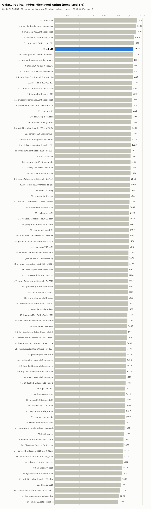

# Galaxy replica ladder

Snapshot of the Rankings page of our private galaxy replica (https://galaxy19.136-86-167-127.sslip.io/bc19/rankings), taken Oct 26 13:58 PDT. Written by `tools/progress/ladder.py` (`tools/progress-refresh.sh`): regenerate it, do not edit it. How to open the live site, with replays: `ACCESS.md`.

**Rating is the replica's displayed rating**: siarnaq's penalized Elo, mean − 1500·0.85^n after n rated matches, so every team starts at 0 and climbs over its first ~20 ranked matches. **BT** is the Bradley-Terry rating of `progress/ELO.md` (± 95%; for our team, the build of our latest submission). Games W-L counts the replica games in `progress/games.csv`. 86 teams; our team is **vibe19**. The field of public 2019 bots is entered (BENCHMARK.md); the replica plays a few matches an hour, so most teams have played few games yet and their ratings are still rising toward their level.

| # | Team | Rating | BT | Games W-L | Submission |
|---:|---|---:|---:|---|---|
| 1 | uvafan.bc2019 | 1636.3 | 1899 ± 54 | 243-114 | accepted |
| 2 | m-schier.battlecode-2019-wololo | 1632.5 | 2011 ± 59 | 287-73 | accepted |
| 3 | mvpatel2000.Battlecode2019 | 1619.6 | 2040 ± 122 | 57-12 | accepted |
| 4 | yujinwunz.battlecode\_2019 | 1584.6 | 1842 ± 103 | 59-25 | accepted |
| 5 | virenvshah.Battlecode2019 | 1576.1 | 1694 ± 104 | 52-23 | accepted |
| 6 | **vibe19** (v12) | 1574.7 | 1904 ± 109 | 971-998 | accepted |
| 7 | IanCoolidge0.battlecode20\~f649f3 | 1571.6 | 1687 ± 98 | 57-36 | accepted |
| 8 | vineetparikh.BigRedBattle\~fe3459 | 1564.3 | 1657 ± 102 | 50-28 | accepted |
| 9 | StoneT2000.BC19-bot1v43 | 1563.0 | 1768 ± 51 | 206-166 | accepted |
| 10 | StoneT2000.BC19-botfinalsafe | 1562.3 | 1800 ± 51 | 220-152 | accepted |
| 11 | IanCoolidge0.battlecode20\~69ce88 | 1559.6 | 1672 ± 51 | 149-208 | accepted |
| 12 | moreda-a.BC2019-a31 | 1554.1 | 1741 ± 105 | 46-23 | accepted |
| 13 | rafekruse.Battlecode-2019-bc19 | 1547.1 | 1862 ± 110 | 47-19 | accepted |
| 14 | j-mao.battlecode-2019 | 1540.4 | 1746 ± 100 | 44-28 | accepted |
| 15 | awesomelemonade.Battlecode2019 | 1539.1 | 1670 ± 52 | 149-199 | accepted |
| 16 | rafekruse.Battlecode-2019\~2680d4 | 1539.0 | 1648 ± 117 | 44-19 | accepted |
| 17 | arya-k.bc19 | 1538.5 | 1725 ± 112 | 43-20 | accepted |
| 18 | bqi343.cp-notebook | 1536.5 | 1668 ± 111 | 44-22 | accepted |
| 19 | dmunozc.bc19-g8-bots | 1531.8 | 1495 ± 106 | 44-28 | accepted |
| 20 | VoidMercy.battlecode-2019\~e7dc06 | 1531.7 | 1859 ± 119 | 44-16 | accepted |
| 21 | cemondr.BC19pdxgroup4 | 1531.7 | 1668 ± 109 | 43-23 | accepted |
| 22 | CS554-software-engineerin\~a575dc | 1525.5 | 1319 ± 76 | 170-123 | accepted |
| 23 | NielsKornerup.Battlecode-2019 | 1522.8 | 1511 ± 90 | 54-48 | accepted |
| 24 | ovkulkarni.battlecode2019\~0aa607 | 1520.7 | 1500 ± 105 | 43-26 | accepted |
| 25 | Tom-CCS.BC19 | 1516.7 | 1447 ± 111 | 42-27 | accepted |
| 26 | dmunozc.bc19-g8-davjasdiv | 1516.1 | 1482 ± 96 | 49-41 | accepted |
| 27 | Nischay-Pro.BattleCode2019 | 1514.8 | 1557 ± 114 | 42-24 | accepted |
| 28 | ldcWV.Battlecode-2019 | 1514.3 | 1625 ± 112 | 40-23 | accepted |
| 29 | UpperArlingtonHighSchool.\~682aa9 | 1510.3 | 1562 ± 116 | 40-26 | accepted |
| 30 | m4reko.bc2019-tmores-angels | 1505.1 | 1469 ± 109 | 40-26 | accepted |
| 31 | twitu.bc19-tsp | 1498.0 | 1255 ± 119 | 41-31 | accepted |
| 32 | unrevre.battlecode | 1496.7 | 1608 ± 118 | 37-20 | accepted |
| 33 | 18dcb01.Battlecode19-prea\~fb5c48 | 1495.2 | 1365 ± 97 | 51-54 | accepted |
| 34 | nthistle.battlecode-2019 | 1491.3 | 1262 ± 114 | 39-36 | accepted |
| 35 | lschaberg.bc19 | 1488.9 | 1487 ± 113 | 36-27 | accepted |
| 36 | howard36.Battlecode2019-eco6 | 1488.5 | 1445 ± 111 | 37-32 | accepted |
| 37 | programjames.BC19Bot-root | 1487.2 | 1267 ± 103 | 41-37 | accepted |
| 38 | cvxluo.battlecode19 | 1486.7 | 1280 ± 109 | 39-36 | accepted |
| 39 | sunanth123.battlecode19-prorush | 1483.7 | 1285 ± 113 | 37-29 | accepted |
| 40 | JasonLarson44.2019-Battle\~1c7639 | 1480.2 | 1164 ± 101 | 40-47 | accepted |
| 41 | spachava753.bc19 | 1477.7 | 1133 ± 120 | 36-30 | accepted |
| 42 | sunanth123.battlecode19-mainbot | 1475.2 | 1208 ± 114 | 37-35 | accepted |
| 43 | programjames.BC19Bot-seeding | 1474.0 | 1404 ± 108 | 35-31 | accepted |
| 44 | evanyeyeye.battlecode2019\~af562c | 1473.6 | 1225 ± 112 | 36-33 | accepted |
| 45 | abcdefguan.battlecode2019 | 1466.9 | 1410 ± 117 | 35-31 | accepted |
| 46 | CometsTech.battlecode2019 | 1463.5 | 1231 ± 80 | 117-141 | accepted |
| 47 | UpperArlingtonHighSchool.\~5e7875 | 1463.1 | 1030 ± 133 | 34-32 | accepted |
| 48 | ipercyNC.group6-battlecode | 1462.2 | 1297 ± 111 | 34-35 | accepted |
| 49 | moreda-a.BC2019-t15 | 1461.9 | 1304 ± 116 | 33-33 | accepted |
| 50 | rooneyshuman.Battlecode | 1461.2 | 975 ± 137 | 34-29 | accepted |
| 51 | TestSubjector.BattleCode2\~fb22c7 | 1461.1 | 940 ± 141 | 38-46 | accepted |
| 52 | vicennial.BattleCode19 | 1457.2 | 1192 ± 113 | 37-44 | accepted |
| 53 | bayoumi17m.BattleCode-2019 | 1453.6 | 1164 ± 119 | 32-31 | accepted |
| 54 | ovkulkarni.battlecode2019\~06c610 | 1453.0 | 1383 ± 113 | 32-28 | accepted |
| 55 | dndoja.battlecode19 | 1449.9 | 957 ± 118 | 33-36 | accepted |
| 56 | haydenshively.Battle-Code\~e1c2fb | 1444.5 | 970 ± 115 | 32-40 | accepted |
| 57 | CometsTech.battlecode2019\~187e8c | 1438.6 | 876 ± 122 | 33-42 | accepted |
| 58 | haydenshively.Battle-Code\~e37b3e | 1431.1 | 960 ± 124 | 29-40 | accepted |
| 59 | TestSubjector.BattleCode2\~e6de74 | 1430.4 | 947 ± 125 | 35-49 | accepted |
| 60 | jamesrayman.HCN-bot | 1428.3 | 1133 ± 116 | 30-45 | accepted |
| 61 | SethKitchen.examplefuncsplayer | 1428.2 | 787 ± 159 | 30-45 | accepted |
| 62 | liwanlin41.examplefuncsplayer | 1427.5 | 772 ± 131 | 40-62 | accepted |
| 63 | roy-love.onshoreBattleCode2019 | 1425.4 | 851 ± 121 | 32-43 | accepted |
| 64 | nhard.examplefuncsplayer | 1419.4 | 617 ± 144 | 30-42 | accepted |
| 65 | 18dcb01.Battlecode19-robot2 | 1416.3 | 809 ± 134 | 30-45 | accepted |
| 66 | dgh2.bc19-t1 | 1414.6 | 764 ± 152 | 28-41 | accepted |
| 67 | jyurkanin.corn\_bc19 | 1411.1 | 711 ± 150 | 27-42 | accepted |
| 68 | jackliu612.Battlecode19 | 1409.4 | 904 ± 164 | 26-28 | accepted |
| 69 | vishwasns99.BC\_2019 | 1409.4 | 543 ± 155 | 26-40 | accepted |
| 70 | waylon531.scala\_starter | 1406.8 | 546 ± 167 | 26-40 | accepted |
| 71 | asunathanr.asu\_bc | 1406.6 | 707 ± 122 | 30-51 | accepted |
| 72 | OmarTahoun.battle-code | 1402.1 | 601 ± 134 | 28-50 | accepted |
| 73 | VictorButoi.BattleCode201\~c4576b | 1397.1 | 680 ± 135 | 26-43 | accepted |
| 74 | bc19-starter | 1392.6 | 250 ± 161 | 77-237 | accepted |
| 75 | howard36.Battlecode2019-sprint | 1376.3 | 574 ± 145 | 22-44 | accepted |
| 76 | DivyanshuSaxena.Battlecode | 1375.0 | 297 ± 165 | 30-57 | accepted |
| 77 | bovard.battlecode-2019-un\~8822c3 | 1369.7 | 464 ± 175 | 21-36 | accepted |
| 78 | RyanSharafuddin.Battlecode\_2019 | 1369.6 | 195 ± 182 | 21-63 | accepted |
| 79 | jbiewend.Battlecode2019 | 1362.1 | 228 ± 190 | 20-43 | accepted |
| 80 | yunaganyh.bc19 | 1348.4 | -131 ± 211 | 18-42 | accepted |
| 81 | ryanhzhao.Battlecode-2019 | 1338.2 | -6 ± 220 | 16-44 | accepted |
| 82 | VoidMercy.battlecode-2019-bot | 1334.1 | 229 ± 205 | 16-41 | accepted |
| 83 | djkeyes.bc19 | 1317.2 | -95 ± 199 | 15-51 | accepted |
| 84 | TheRobotCarlson.battlehac\~323871 | 1312.3 | -270 ± 197 | 20-70 | accepted |
| 85 | jamesrayman.HCN-basic-bot | 1289.7 | -304 ± 210 | 11-52 | accepted |
| 86 | jshin313.battlecodebot | 1272.6 | -346 ± 222 | 8-52 | accepted |

## Latest matches

| Match | Created | Player 0 | Score | Player 1 | Maps | Type | Status |
|---:|---|---|---|---|---|---|---|
| 1876 | Oct 26 12:26 PDT | IanCoolidge0.battlecode20\~69ce88 | 1–2 | **vibe19** | seed-1036, seed-203, seed-2644 | unranked | OK! |
| 1875 | Oct 26 12:26 PDT | **vibe19** | 1–2 | IanCoolidge0.battlecode20\~69ce88 | seed-1036, seed-203, seed-2644 | unranked | OK! |
| 1874 | Oct 26 12:26 PDT | awesomelemonade.Battlecode2019 | 0–3 | **vibe19** | seed-1712, seed-2797, seed-2518 | unranked | OK! |
| 1873 | Oct 26 12:26 PDT | **vibe19** | 3–0 | awesomelemonade.Battlecode2019 | seed-1712, seed-2797, seed-2518 | unranked | OK! |
| 1872 | Oct 26 12:11 PDT | uvafan.bc2019 | 1–2 | **vibe19** | seed-1653, seed-1712, seed-2046 | unranked | OK! |
| 1871 | Oct 26 12:11 PDT | **vibe19** | 2–1 | uvafan.bc2019 | seed-1653, seed-1712, seed-2046 | unranked | OK! |
| 1870 | Oct 26 12:11 PDT | StoneT2000.BC19-bot1v43 | 1–2 | **vibe19** | seed-2591, seed-2321, seed-388 | unranked | OK! |
| 1869 | Oct 26 12:11 PDT | **vibe19** | 3–0 | StoneT2000.BC19-bot1v43 | seed-2591, seed-2321, seed-388 | unranked | OK! |
| 1868 | Oct 26 12:11 PDT | StoneT2000.BC19-botfinalsafe | 1–2 | **vibe19** | seed-2740, seed-1706, seed-203 | unranked | OK! |
| 1867 | Oct 26 12:11 PDT | **vibe19** | 1–2 | StoneT2000.BC19-botfinalsafe | seed-2740, seed-1706, seed-203 | unranked | OK! |
| 1866 | Oct 26 12:11 PDT | m-schier.battlecode-2019-wololo | 1–2 | **vibe19** | seed-2644, seed-836, seed-2013 | unranked | OK! |
| 1865 | Oct 26 12:11 PDT | **vibe19** | 1–2 | m-schier.battlecode-2019-wololo | seed-2644, seed-836, seed-2013 | unranked | OK! |
| 1864 | Oct 26 11:19 PDT | StoneT2000.BC19-bot1v43 | 1–2 | **vibe19** | seed-1822, seed-2924, seed-2321 | ranked | OK! |
| 1863 | Oct 26 11:19 PDT | IanCoolidge0.battlecode20\~69ce88 | 1–2 | **vibe19** | seed-1592, seed-2674, seed-388 | ranked | OK! |
| 1862 | Oct 26 11:19 PDT | **vibe19** | 3–0 | moreda-a.BC2019-a31 | seed-1706, seed-2013, seed-2740 | ranked | OK! |
| 1861 | Oct 26 11:19 PDT | **vibe19** | 3–0 | vineetparikh.BigRedBattle\~fe3459 | seed-826, seed-1653, seed-1884 | ranked | OK! |
| 1860 | Oct 26 11:19 PDT | **vibe19** | 2–1 | StoneT2000.BC19-botfinalsafe | seed-747, seed-1884, seed-705 | ranked | OK! |
| 1859 | Oct 26 11:19 PDT | **vibe19** | 1–2 | IanCoolidge0.battlecode20\~f649f3 | seed-493, seed-2057, seed-799 | ranked | OK! |
| 1858 | Oct 26 11:19 PDT | IanCoolidge0.battlecode20\~69ce88 | 1–2 | **vibe19** | seed-1036, seed-203, seed-2644 | unranked | OK! |
| 1857 | Oct 26 11:19 PDT | **vibe19** | 1–2 | IanCoolidge0.battlecode20\~69ce88 | seed-1036, seed-203, seed-2644 | unranked | OK! |
