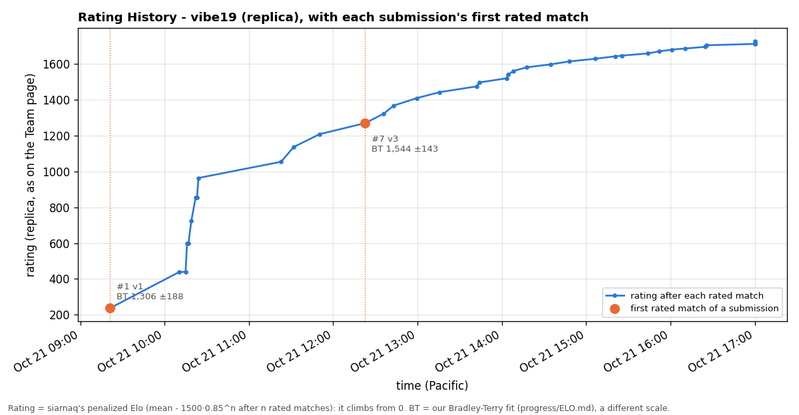

# Rating history (replica)

The replica's Team page Rating History for vibe19: the displayed rating (siarnaq's penalized Elo) after each rated (ranked, non-tournament) match, with each submission's first completed rated match marked. Written by `tools/progress/rating_history.py` from data fetched 2026-10-22 08:50 PDT; regenerate, do not edit.

38 rated matches; latest rating 1,725 (2026-10-21 17:00 PDT). Times are Pacific; the replica's chart shows UTC.

BT = the build's Bradley-Terry rating in `progress/ELO.md` (± 95%), the same for every submission of a build.

| Submission | Build | First rated match | Time | Rating before | Rating after | Rated matches | BT |
|---:|---|---:|---|---:|---:|---:|---:|
| #1 | v1 | 1 | 2026-10-21 09:21 PDT | 0 | 237 | 12 | 1306 ± 188 |
| #7 | v3 | 66 | 2026-10-21 12:22 PDT | 1,208 | 1,270 | 26 | 1544 ± 143 |
